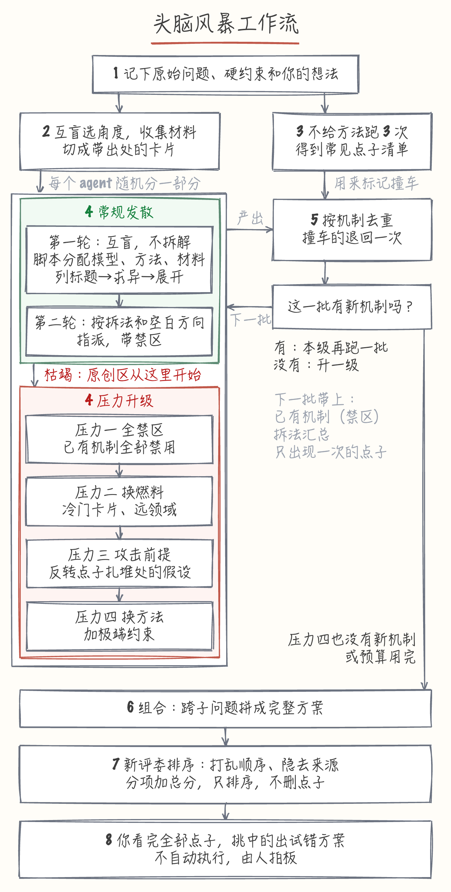

# 头脑风暴技能：9 件事的裁决结果

> **历史文档，不代表现状。** 这是 2026-11 发布 v1 之前的设计稿，保留只为留痕。发布的技能没有照这份稿子做完，以 [skills/brainstorm](../../skills/brainstorm/README.zh.md) 为准。差别见本目录的 [README](README.md)。

Audience:   P1 审批 owner
Scope:      头脑风暴技能的流程与评测方案 / Non-scope: 技能正文和跑分脚本的实现
State:      approved
Genre:      G-APPROVAL
Code-Root:  none
Prefixes:   U-DEC

> 状态说明（2026-11-11）：作者决定先发布 v1，只评了一道题。下文第 3 节「公开仓库要等考题验证之后」和第 5 节「每个机制都有保留或删除的结论」两条没有做到，逐机制的去留结论留到以后。其余正文保持原样。

## 决策地图

```d2
direction: down
流程: "agent 怎么想点子\n已定" { class: box }
评测: "怎么算一次改动有用\n已定" { class: box }
预算: "分步跑，50 美元封顶\n已定" { class: box }
流程 -> 评测: 跑出点子给你看
评测 -> 预算: 按这个分数决定跑多少
```

这 9 件事都拍完了，下面记录结果。

## 1. 现在哪儿坏了、不改会怎样

上次的图书馆题实测里，同一个 Claude 跑 3 次，10 个点子有 7 类相同。不改流程，你让 agent 头脑风暴，拿到的还是这些一眼能想到的点子。

### 核心概念

- **机制**：一个点子真正起作用的做法，不是它的说法。比如「周六下午专场」和「周末青少年专属时段」措辞不同，机制相同。
- **枯竭**：一批 agent 再也想不出新机制的时刻。比如第三批的 10 个点子全部和前两批重复。

## 2. 要你拍的事

这一轮没有了。公开仓库前会再问你。

## 3. 撤不回来的与会变的

这一轮没有撤不回来的动作。所有东西都在本地，公开仓库要等考题验证之后，公开前会再问你。

## 4. 代价、新增依赖与运维负担

- **预算**：约 36 美元（Sonnet，按 API 价折算），不含去重、评委和重跑，跑分脚本在 50 美元处硬停。
- **你的时间**：每轮约 10 分钟（40 条，按每条 15 秒估算，还没实测）。三问比一问慢，实际可能更久。去重校准人工分组约 10 分钟，造好的考题也要过目。
- **一次真试**：在你的真实问题上，从你标了「不想试」但计分的点子里抽 2 条真试一次，用来检验这个计分规则。只抽 agent 能低成本做出原型的点子，没有这样的点子就跳过。
- **新增依赖**：无。

## 5. 分几期、多久、每期拿到什么、怎么算做完

先做去重底座，再造题，再搭跑分脚本，然后按机制逐组测试，最后用留下的 3 道题验收。做完的判据是每个机制都有保留或删除的结论，并写进 README。

## 6. 最可能翻车的假设

「说不出致命原因」能否挡住胡话，还没验证。在你不熟的领域，胡话也可能挑不出毛病。处置：考题选你熟悉的领域，并混入几条明显不行的点子。如果它们也常常计分，这条规则就要改。

「成了会在乎」能否躲开稳妥偏好，也没有实验直接支持，只有研究发现改变挑选要求会改变挑出的结果（Rietzschel 2010）。处置：用前瞻题和真试作为外部检查。

枯竭后的点子是否真的更好，只有人类实验支持。处置：需要验证，考题会比较计分的点子有多少来自枯竭之后。

## 7. 已定死不用你看的

公开技能库叫 `xiaolang-skills`，头脑风暴是第一个技能。要多轮，保留总分，试错只出方案，枯竭后进入压力升级。

- **① 记不起来的方法**（[U-DEC-1|391b]）：就是文章里的三步法，已放进流程。
- **② 多模型**（[U-DEC-2|6e0c]）：公开版默认关闭，读者配置后才开，你本机配好六家。
- **③ 流程**（[U-DEC-3|a672]）：改成 8 步，收集材料和跑常见点子清单同时做，各轮生成合成一步。
- **④ 四级压力**（[U-DEC-4|8ae4]）：枯竭之后先用这四级，测不出贡献的级别就删掉。
- **⑤ 大胆点子**（[U-DEC-5|b4a2]）：不留名额。排名只排序，不清理，所有点子都给人看。
- **⑥ 怎么算一次改动有用**（[U-DEC-6|f3fb]）：没想到、成了会在乎、说不出致命原因的点子才计分，想不想试只记录。
- **⑦ 考题和预算**（[U-DEC-7|5196]）：开发题 5 道、留出题 3 道；按分步跑，设 50 美元硬上限，到线就停下来问你。
- **⑧ 公开**（[U-DEC-8|0a17]）：考题和跑分结果公开，你的私人问题和许可证不清楚的外部数据除外。
- **⑨ 流程图**（[U-DEC-9|af95]）：用暖色手绘。



## 8. 没写进这一页的

17 个机制的假设和完整评测方案不在这一页，在同目录的 `mechanisms.md` 和 `evaluation.md`。
