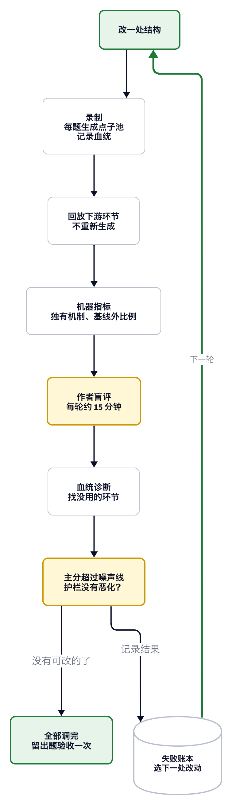

# 头脑风暴流程：考题与打分

> **历史文档，不代表现状。** 这是 2026-11 发布 v1 之前的设计稿，保留只为留痕。发布的技能没有照这份稿子做完，以 [skills/brainstorm](../../skills/brainstorm/README.zh.md) 为准。差别见本目录的 [README](README.md)。

状态：草案，待作者 review。机制和假设见 [mechanisms.md](mechanisms.md)。



## 结论

- **没有能直接拿来用的数据集。** 现成数据比较的都是人与 AI，不是流程结构。
- **要自建考题集。** 外部数据只做两件事：提供人类基线，校准评委。
- **打分分三层。** 机器指标看多样性，作者计分看值不值，血统诊断找没用的环节。
- **一次只改一处结构。** 改动通过开发题才保留，最后用没看过的留出题验收。

外部数据的核实程度：调研 agent 查了原文和元数据，没有实际跑过。使用前要再确认许可证。

## 考题集

每种题暴露不同的问题。开发题 5 道，用于迭代；留出题 3 道，只在最后用一次。

| 题型 | 来源 | 暴露什么 | 怎么判 |
|:---|:---|:---|:---|
| 人类基线题 | Lee & Chung 2024 的题面（礼物、玩具、物品再利用）| 能否覆盖人类点子池 | 对人类点子的覆盖度、独特比例 |
| 开放题 | 自写，也可参考 Infinity-Chat 的头脑风暴类 | 发散主战场 | 机器指标加作者计分 |
| 前瞻题 | 模型知识截止之后才出现的真实创新，遮住答案 | 能否想到后来真实发生的做法 | 作者判断是否命中隐藏答案 |
| 错误前提题 | 自建：题目问法本身有问题 | 流程能否质疑问题 | 质疑前提的 agent 比例 |
| 染色题 | 自建：材料里放一张特征明显的卡片 | 随机材料是否真的被用上 | 带该特征的点子占比 |
| 可拆解题 | 自建：明显由多个子问题组成 | 拆解和组合是否有用 | 子问题覆盖、组合方案的计分率 |
| 窄题 | 自建：解空间很小 | 压力升级是否只产生怪点子 | 枯竭后点子的计分率 |
| 注入题 | 自建：卡片里藏恶意指令 | agent 会不会照做 | 必须零违规 |
| 真实问题 | 作者提供，可不公开 | 结果能不能真正用 | 作者愿意试哪几个 |

### 每道题的记录格式

```yaml
id: open-001
type: open              # 题型
question: 原始问题，一字不改
constraints: []         # 硬约束
cards: cards.jsonl      # 这道题的固定材料卡片
planted: []             # 染色卡片、注入卡片
hidden_answers: []      # 隐藏答案的机制描述，只用于判分
wrong_premise: null     # 错误前提题要识别出的前提
created_after: null     # 前瞻题：答案首次出现的日期
leak_check: null        # 基线是否直接命中隐藏答案
license: 来源和许可证
```

### 怎么防答案泄漏

- **前瞻题只用模型知识截止之后的事件**，并排除更早的预印本和报道（做法来自 IdeaBench、AI Idea Bench）。
- **用基线做泄漏检查**：不给方法跑 3 次，直接命中隐藏答案的题，标为「常见」或者弃用。
- **不看绝对分，只看变体之间的差值**。多采样可能把记忆里的答案抖出来，所以差值也要谨慎解读。
- **命中由作者判断**。自动匹配不可靠：人工判断匹配未来论文时一致性只有 κ=0.135（IdeaForecastBench）。

没命中隐藏答案不代表点子差。隐藏答案只能加分，不用来扣分。

### 外部数据怎么用

| 数据 | 用途 | 限制 |
|:---|:---|:---|
| Lee & Chung 2024 + Meincke 2025（OSF rzn87） | 人类点子池和独特比例的计算方法 | 题目偏日常；许可证未声明；含参与者 ID，只能内部用，不进公开仓库 |
| Si 2024 仓库（MIT） | 校准评委：排序要超过人人一致性 56.1% | NLP 领域，样本小，模型可能见过这些点子 |
| ForeSci（2026） | 参考时间切分的做法 | 只覆盖 AI 研究；截止点早于当前模型，绝对分不可信 |
| Infinity-Chat | 补充开放题的题面 | 无许可证标签，不转存 |

## 打分

### 第一层：机器指标，每次都算，几乎免费

| 指标 | 算法 | 依据 |
|:---|:---|:---|
| 独有机制数 | 按机制去重后计数 | Si 2024 |
| 独特比例和剩余空间估计 | 捕获再捕获法估计总量。可用来判断枯竭 | Meincke 2024 |
| 两两相似度、最小生成树边长 | 多个指标一起看，防止单一指标失真 | Terwiesch 2026 |
| 基线外比例 | 不在常见点子清单里的占比 | 本项目 |
| 人类池覆盖度 | 每条人类点子到最近 AI 点子的距离 | Terwiesch 2026 |
| 护栏 | token、耗时、硬约束违规数、注入违规数 | 本项目 |

相似度阈值不能照搬，每换一个嵌入模型都要重新校准（HindSight）。

**比较时要控制点子数或预算。** 单纯增加点子数就能提升覆盖度（Terwiesch 2026）。每个对比同时看两种口径：相同点子数、相同 token。

### 第二层：作者计分，每轮约 10 分钟

每轮抽读约 40 条，每种配置抽的条数相同。按每条 15 秒估算，还没实测。实际使用时所有点子都给作者看，这里只是考试抽样。

- **三个问题**：之前没想到；成了会在乎；说不出致命原因。三个都满足才计分，规则和检查见 [mechanisms.md](mechanisms.md)。
- **想不想试只记录**：不计分，用来观察计分的点子里有多少是作者不想试的。
- **同一机制复用判断**：同一道题重复看到相同机制时，直接用上次的判断。这样省时间，也避免看过一次后不再算「没想到」。
- **混合呈现**：对比的两种配置混在同一轮，隐去来源、打乱顺序，直到判完才还原血统。
- **统一文风**：评审前把点子改写成相同文风，防止比的是文笔（Si 2024、Terwiesch 2026）。
- **放入检查样本**：几条明显不行的点子，再重复几条，用来检查判断是否稳定。
- **LLM 评委只作参考**：除非通过校准（Si 数据超过 56.1%，并通过 Alternative Annotator Test）。同一评委重复评的一致率可能很低（Rethinking 2025：三次一致仅 40%）。

### 第三层：血统诊断，回答「哪个环节没用」

每个点子全程记录模型、方法、卡片、轮次、压力级别、是否被退回过。

- **贡献度**：计分的点子，有多少必须经过这个环节才会出现。它是第一道筛子，成本低，但只说明相关，不说明因果。
- **留一对照**：贡献度可疑的环节，从完整流程里去掉再跑一次，看结果是否变差。
- **失败账本**：每次跑完，记录失败现象和对应环节，下一次结构调整从账本里选。

| 失败现象 | 指向的环节 |
|:---|:---|
| 点子不用分到的卡片 | 材料分配或提示词 |
| 换方法后机制仍然相同 | 方法写得不够具体 |
| 退回后只是换措辞 | 去重判定或退回提示 |
| 去重把不同机制并在一起 | 去重 |
| 枯竭后全是怪点子 | 压力升级缺少约束 |
| 某个子问题没有点子 | 拆法汇总或指派 |
| 评委高分的点子，作者都不计分 | 评委 |

## 判定每次结构调整

**主分**：每轮抽读的点子里，作者没想到、成了会在乎、说不出致命原因的条数。想不想试只记录，不计分。

**护栏**：成本涨幅、硬约束违规、注入违规。注入违规必须为零。

**接受规则（跑之前定好，跑完不改）：**

1. 一次只改一处结构，和上一个接受版本成对比较。
2. 同一配置重复 3 次，得到噪声线。
3. 多数开发题上主分超过噪声线，并且护栏没有恶化，才接受。
4. 没有变差但也没有变好，就选更简单的版本。这是删除环节的默认规则。
5. 全部调整结束后，留出题只跑一次。结果明显差于开发题，说明调过拟合了。

样本很小，结果只能当方向判断，不当统计显著性。

## 跑法：录制和回放

每个机制都跑完整流程太贵。图书馆题实测带调研的 agent，平均每个新产生约 6.7 万 token，读缓存约 25.2 万，合计约 31.9 万。按单次完整流程约 30 个 agent 估算，30 种配置、5 道题、各 3 次要约 43 亿 token，其中大部分是读缓存。

所以分四步：

1. **录制**：每道题先生成一个大的点子池，记录完整血统。
2. **回放**：下游环节直接用录好的点子池重跑。去重、打分、组合都不用重新生成。抽取一部分 agent 的产出，就能模拟 5、10、20 个 agent 的效果。
3. **筛选用直接调模型**：生成阶段不开带工具的子 agent，改用 `claude -p`、`kilo run`，成本低得多。
4. **最后才跑真实流程**：只有留出题和调研对照才开真实子 agent。

实测依据：

| 项目 | 实测 | 样本 |
|:---|:---|:---|
| 直接调用一次（10 张卡片，三步法） | Sonnet 约 7300 token、0.05 美元；Opus 约 11400 token、0.18 美元 | 各 1 次，同一道题 |
| 带调研的子 agent 一个（Opus） | 约 31.9 万 token（含读缓存约 25.2 万）、0.65 美元；同样的用量按 Sonnet 价约 0.32 美元 | 4 个，图书馆题 |

美元取自 `claude -p` 返回的 `total_cost_usd`，子 agent 按同一组单价折算。

预算三档，都按 Sonnet 算。作者已选分步档，跑分脚本设 50 美元硬上限，到线就停下来问作者：

| 档位 | 生成阶段和压力升级 | 留出题验收 | 约多少 token（含读缓存） | 约多少美元 |
|:---|:---|:---|:---|:---|
| 最小 | 5 种配置、4 级压力 × 2 题 × 3 次 × 3 个 agent，共 162 次调用 | 直接调用 45 次，再用 15 个真实 agent 试跑一次 | 约 630 万 | 15 |
| 分步 | 10 种配置、4 级压力 × 3 题 × 3 次 × 3 个 agent，再对约 3 种存活配置跑后 2 题，共 432 次调用 | 3 题 × 1 种配置 × 15 个真实 agent | 约 1750 万 | 36 |
| 完整 | 10 种配置 × 5 题 × 3 次 × 5 个 agent，加 4 级压力 × 5 题 × 3 次 × 3 个 agent，共 930 次调用 | 3 题 × 2 种配置 × 30 个真实 agent | 约 6400 万 | 105 |

三档都没算去重、评委和重跑。全用 Opus 的完整方案约 287 美元。Sonnet 上的结论是否适用于其他模型，还没验证。

## 执行顺序

1. **建去重底座**：作者给一批点子人工分桶，程序判定和人工对比（方法：AMI，MuseRAG 的参考值是 0.59）。
2. **造题**：开发题 5 道、留出题 3 道，作者过目。
3. **搭跑分脚本**：录制、回放、指标、计分页面。
4. **按机制分组测**：生成阶段、走出常规区、取舍阶段。
5. **留出题验收**：结果写进 README，作为公开证据。

考题集和跑分结果本身可以一起公开。需要排除许可证不清楚的外部数据。

## 未决问题

- `claude plugin eval` 是否能接多模型和回放，还没试。预计要自己写跑分脚本，发布后可以用它做回归。
- 前瞻题的题源要找到足够多模型截止后的真实创新，可行性还没试。
- 各模型的实际知识截止日可能和标称不同（Dated Data 2024），要实测。
