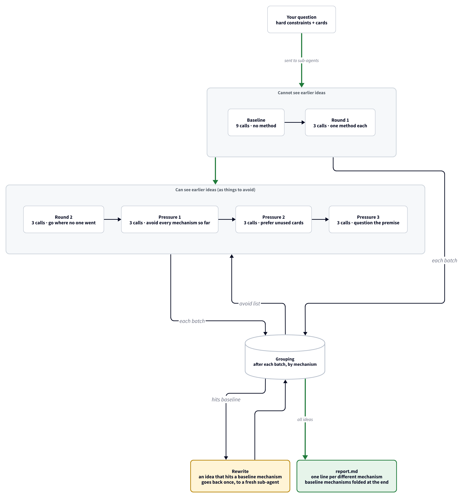
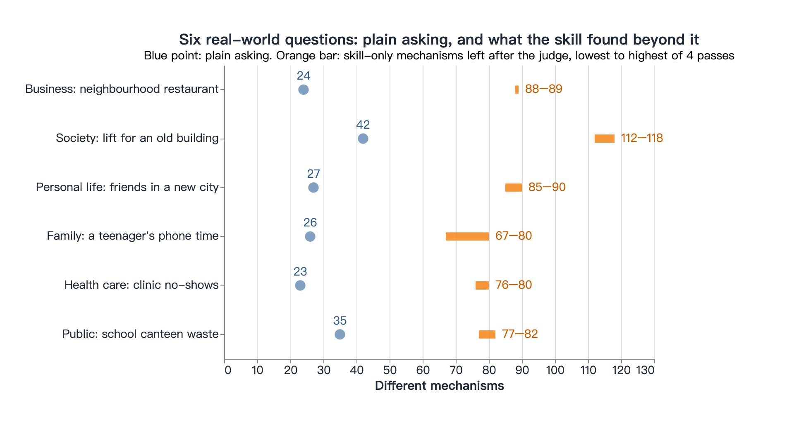
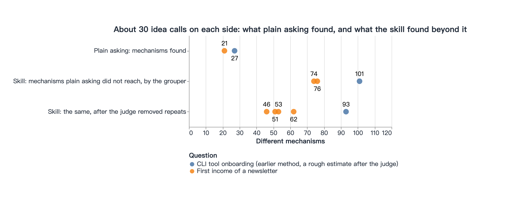
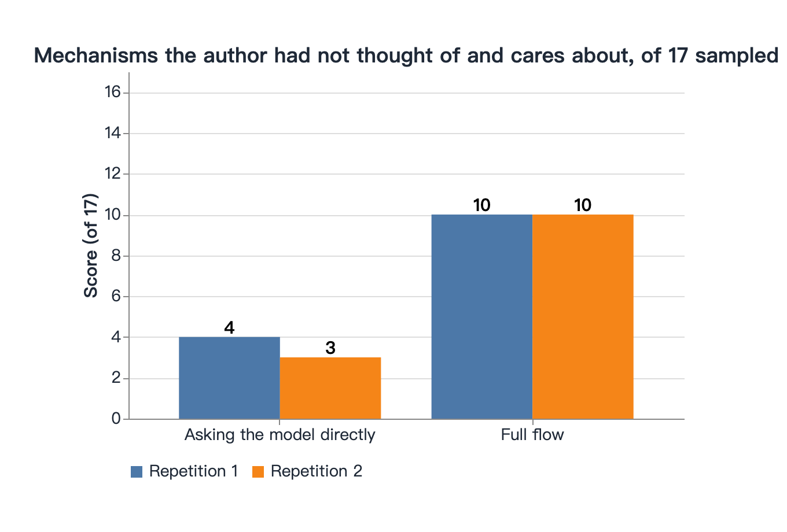
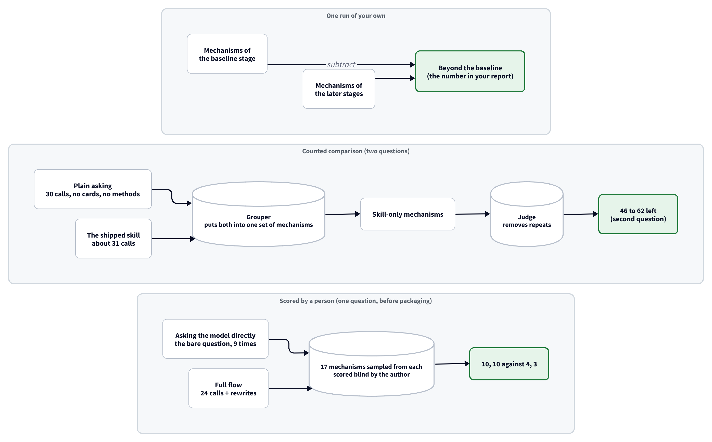
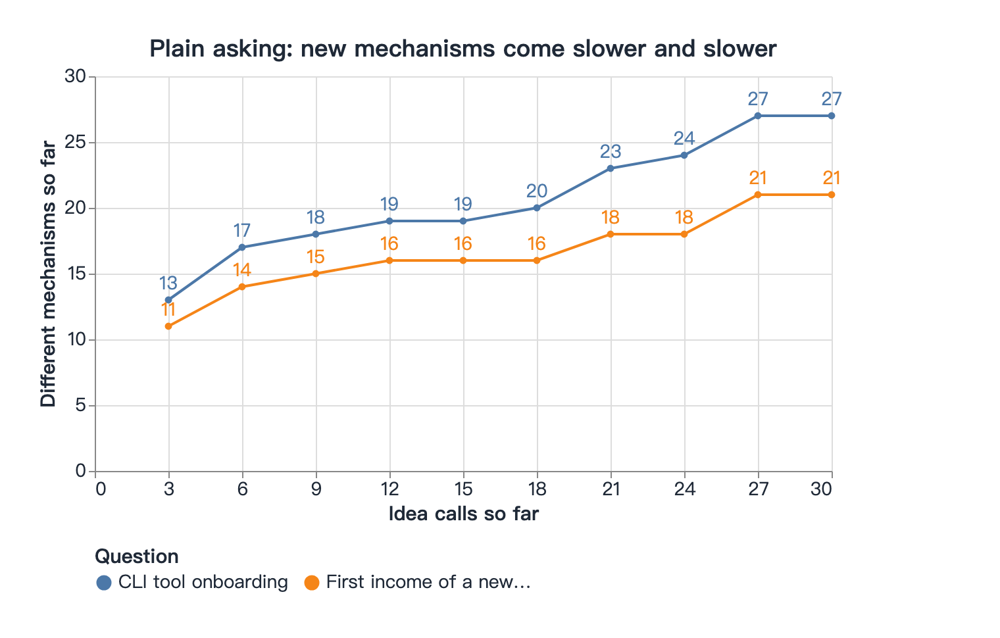
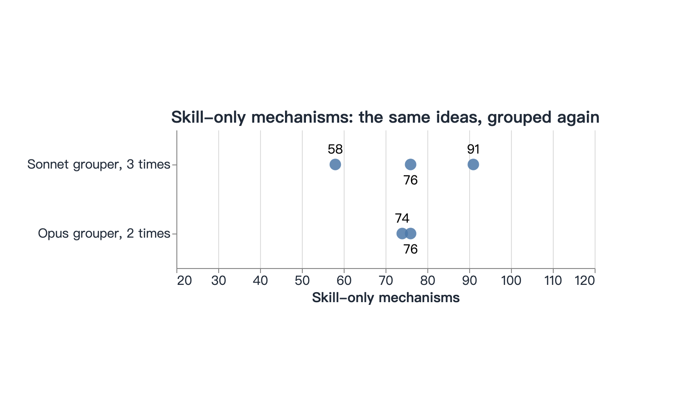
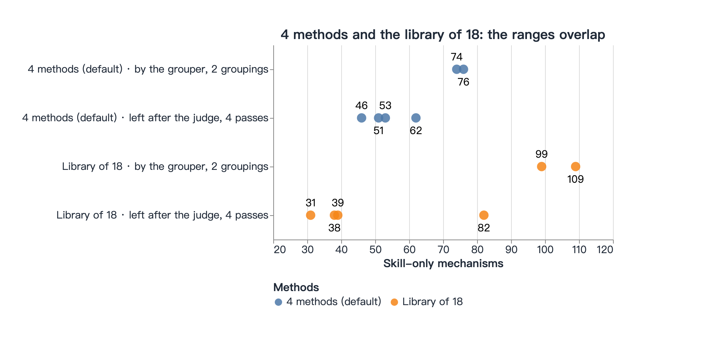

# brainstorm

[中文](README.zh.md)

Brainstorming that spreads ideas wide before judging any of them. This page is for people. The instructions your agent reads are in [SKILL.md](SKILL.md).

The page has four parts:

1. [Method](#1-method): how it keeps ideas from piling up on the same answers.
2. [What the skill adds](#2-what-the-skill-adds): what you get beyond not using it, and what it costs.
3. [Cases](#3-cases): ideas on eight open questions that only the skill reached.
4. [Experiments and findings](#4-experiments-and-findings): what each measurement measured, what it found, and where it is weak.

## 1. Method

### The core idea

Ask one model the same question again and again and it keeps falling back on the same few kinds of answer. The skill does three things to push the answers apart:

- **Isolation.** The question goes to many sub-agents that cannot see each other.
- **Different starting points.** Each sub-agent gets a different thinking method and different cards of material.
- **Naming what to avoid.** From round 2 on, a sub-agent sees the ideas found so far, but as things to avoid, not as examples to follow.

A script groups the ideas by mechanism (what makes an idea work). You get every different mechanism; the ones the first stage already produced, with no method, are folded at the end.

It only diverges. It never scores, ranks or deletes ideas; choosing is your job.

### How one run works

| Stage | Idea calls | What a sub-agent is told | What it can see of earlier ideas |
|:---|---:|:---|:---|
| Baseline | 9 | The question, constraints and cards. No method. | Nothing |
| Round 1 | 3 | The same, plus one thinking method each | Nothing |
| Round 2 | 3 | The same, plus: explore the parts of the question not yet covered | One idea per mechanism found so far, to avoid; the ways earlier agents split the question; titles of the ideas that stand alone in their mechanism, as starting points |
| Pressure 1 | 3 | Avoid every mechanism found so far | The same three things, now longer |
| Pressure 2 | 3 | Prefer cards no agent has received yet | The same |
| Pressure 3 | 3 | Question the premises of the question | The same, plus how often each way of splitting was used |

- **The first two stages are blind on purpose.** They give several starting points that did not influence each other.
- **From round 2 on, earlier ideas are shown as things to avoid**, not as examples to follow.
- **Ideas that repeat a baseline mechanism go back once.** In every stage after the baseline, a fresh sub-agent with the same method and cards gets such ideas and the avoid list, and rewrites them. These rewrites are the calls beyond the 24 in the table: up to 3 per stage, and 7 in the second measured run.
- **Pressure 2 seldom has a new card to give.** The nine baseline agents each get half the cards, so with ten cards every card is normally taken before pressure 2. Its agents then get cards that were used before.
- **Grouping.** A sub-agent groups the new ideas by mechanism after each batch (three times in the baseline) and again after the rewrites of a stage: 12 grouping calls in the second measured run. Grouping only merges; every idea stays visible in the report.

### Thinking methods

Thinking methods are data, not code. The four defaults: borrow a practice from an unrelated field, reverse a premise, stand in the place of the person most affected, use resources that sit idle. A larger set of 18 is in [methods/library.jsonl](methods/library.jsonl) (`--methods library`); you can add a line there or pass your own file. The larger set has shown no gain so far (see part 4).

The method texts are in English. Every measurement before 2026-11-16 used Chinese texts with the same meaning. The English texts were measured once on the second question, and the counts came out lower than with the Chinese texts (see "Chinese method texts against English ones" in part 4); with one run on each side it is not known whether the language or plain run-to-run variation caused this. Sub-agents still answer in the language of the question.

### When and how to use it

- **Use it for an open question** where you want options you have not thought of.
- **Do not use it** to choose between known options, to fix a bug, or for a quick list of a few ideas.
- **It is expensive.** The second counted run used 31 idea calls and 12 grouping calls, about 43 sub-agent calls. The script stops and asks before the most expensive part.

Ask your agent to brainstorm a question and give it your hard constraints (things no idea may break). If you have notes or source material, hand them over: the agent cuts them into cards and each sub-agent gets a random half. You get `report.md`: a contents list with one line per mechanism, then every mechanism with all the ideas grouped under it and where each idea came from.

Two profiles: **full** (default) runs every stage in the table above, and it is what the measurements below measured; **economy** stops after round 2, is cheaper, and was not measured on its own.

## 2. What the skill adds

### In short

- **On real-world problems in six directions, it reached mechanisms plain repeated asking did not**: one question each in society, business, personal life, family, health care, and public life. At the same number of calls, plain asking found 23 to 42 mechanisms; the skill reached another 67 to 118 (after the judge).
- **Scored blind by the author, it gave more than twice as many ideas that were new and worth caring about.** One question only. Of 17 mechanisms sampled per repetition, the full flow had 10 and 10, asking the model directly 4 and 3.
- **At the same number of calls, it reaches mechanisms that plain repeated asking does not.** On the one question measured with care, plain asking found 21 mechanisms in all; the skill reached another 46 to 62 (Chinese method texts). The English texts shipped now were measured once and reached another 33 to 39.
- **The price is money.** In the scored test the full flow cost about 28 times as much to generate ideas as asking directly.

| | Without the skill | With the skill |
|:---|:---|:---|
| Scored blind: new and worth caring about, of 17 | 4, 3 | 10, 10 |
| Different mechanisms at about 30 calls (second question, Chinese method texts) | 21 | another 46 to 62 |
| The same, English method texts shipped now | 21 | another 33 to 39 |
| Six new questions, about 30 calls each (English method texts) | 23 to 42 | another 67 to 118 |

| Cost of idea generation (scored test) | 1 times | about 28 times |

### Where the gain comes from

In the scored test, the author marked 18 different mechanisms of the full flow, over both repetitions, as new and worth caring about. By the stage that first produced each:

| First produced in | Baseline | Round 1 | Round 2 | Pressure 1 | Pressure 2 | Pressure 3 |
|:---|---:|---:|---:|---:|---:|---:|
| Mechanisms | 3 | 3 | 2 | 4 | 3 | 3 |

- **More than half came from stages that see the avoid list**: 12 from round 2 and the three pressure stages.
- **This is not proof for any single stage.** No step was removed and measured again (see part 4).

### Discounts to apply

- **Different is not useful.** The counts count different mechanisms. Usefulness was scored on one question only.
- **Eight counted, one scored.** Nobody judged whether the ideas on the six new questions are good.
- **One run per side on each question.** How much two runs on one question differ was not measured.
- **The cards of the six new questions were drafted by a model**, not checked against sources and not seen by the author.

## 3. Cases

Every idea below is taken from a real run. Its meaning is unchanged; it is only cut down to one line. The full texts and the rules for picking them are in [`2026-11-16-cases.json`](../../evals/brainstorm/results/2026-11-16-cases.json). The runs were in Chinese; these lines are translations.

### CLI onboarding: scored blind by the author

**Question.** How can a personally maintained open-source CLI lower the share of new users who fail on their first try? Hard constraints: no telemetry; the maintainer has 2 hours a week.

**How picked.** The author marked the mechanism "had not thought of this", "I care about this" and gave no fatal reason, and no idea from asking directly fell into it. 14 mechanisms met this; here are 6. The author answered "want to try" for all 6.

| Idea | How it works | From |
|:---|:---|:---|
| Copy the AED voice prompt: `tool next` | A defibrillator does not expect anyone to read a manual; it says only the next step. The tool reads the real state of the machine and prints the one thing to do now with its command; every error ends with "Not sure what to do next? Run tool next" | Pressure 2, borrow from another field; pressure 3, stand in the user's place |
| Copy how compilers report errors | An error does not point at the tool's own call stack. It echoes the user's input, marks the wrong spot with `^^^`, and gives a small example of a valid form | Pressure 1, reverse a premise |
| An issue form that triggers a reproduction | The form fixes four fields: system, shell, install channel, version. When the maintainer adds a label, CI installs the tool with the official command on that system and shell and posts the result back to the issue | Pressure 3, use idle resources |
| Stop a same-named program from taking over | Before release, check the package managers for the name; `--version` always prints "name version project URL"; the install script ends by checking PATH for another program of the same name | Pressure 1, pressure 3 |
| The repository's About line is the real first screen | Many people see only the one-line summary in search results before they open the README. Write it as "what it does, systems, install command", and put the same command on the social preview image | Pressure 1, stand in the user's place |
| Read other tools' failures first | Your own issues are too few, so search the issues of similar tools for install failures now and then, ask of each "would mine fail the same way?", and if so add a check | Pressure 3, use idle resources |

### First newsletter income: checked by the judge, not scored by the author

**Question.** How can a one-person Chinese tech newsletter earn its first income within three months? Hard constraints: no more than 5 hours a week; no courses, no paid groups.

**How picked.** Skill-only mechanisms that the judge called a repeat of plain asking in neither pass. 70 mechanisms met this; here are 6. The author has not scored this question, so these show only that plain asking did not reach them, not that they are good.

| Idea | How it works | From |
|:---|:---|:---|
| Copy energy performance contracts: share of cloud savings | Look at a small team's cleaned bill, suggest two or three changes that they make themselves; take an agreed share of the money actually saved against the average of the three months before, and nothing if nothing is saved | Pressure 2, borrow from another field |
| Test what AI assistants get wrong about a tool | Ask the main AI assistants the questions readers really asked in the comments, mark each answer right, wrong or out of date against the official docs, and sell the tool's team one page of wrong answers and the doc pages to add | Pressure 3, reverse a premise |
| Reachability tests from inside China | Run your own install-check script on home broadband and a phone hotspot, measure downloading and installing foreign tools, and sell the report to tool makers going abroad | Pressure 3, use idle resources |
| Find technical mistakes before a tech outlet publishes | Tech media and company accounts that do not know the technology get one page of "technical mistakes and fixes" within 24 hours before publishing, at a fixed price per article | Pressure 3, stand in the affected person's place |
| Copy a journal's guest editor | Put together one special issue for a vendor's developer blog or community: invite authors, unify the style, edit once, and take an editing fee per issue without writing any article yourself | Pressure 2, borrow from another field |
| Auction an exclusive window for a script | Keep a much-asked-for script closed; the company that bids highest uses it alone for six months, then the source goes public | Pressure 3, use idle resources |

### Six new questions, one per direction: checked by the judge, not scored by the author

**How picked.** Skill-only mechanisms that the judge called a repeat of plain asking in neither pass, two per question. The author has not scored these questions.

| Direction | Idea | How it works | From |
|:---|:---|:---|:---|
| Business | Ask at the till: "One to take home?" | Delivery apps take a cut, so sell a second portion to guests already in the room. Charged at the restaurant's price, no app, no commission | Pressure 1, reverse a premise |
| Business | Design the menu like a car platform | Let a dozen best sellers share five or six bases and toppings, so each ingredient is bought in larger amounts and the merged volume is used to bargain with suppliers | Pressure 2, borrow from another field |
| Society | No payment until the ground floor signs | Put the residents' own money in escrow and pay it out by building stage; each payment waits until the ground-floor household confirms the promises of the last stage were kept, so they hold the gate instead of being told | Pressure 2, use idle resources |
| Society | Copy a theatre's restricted-view discount | Grade each flat's loss (blocked window, narrower path, steps still to climb), publish a discount table in advance, and let the table set each household's share, with no flat-by-flat bargaining | Pressure 2, borrow from another field |
| Personal life | Mind the homes of peers with families | Feed their pets and water their plants for free when they travel. Handing over a key is deep trust; it takes none of their evenings and nobody has to make the first invitation | Pressure 1, use idle resources |
| Personal life | Check in on nights of extreme weather | On a typhoon, blackout or snowstorm night the whole city is awake, which gives a first late-night call a reason everyone understands; keep a small group that talks only on such nights | Pressure 2, use idle resources |
| Family | Parents drop one old rule first | Each month, publicly cancel one rule the child resents most, saying it is not a trade; then invite the child to suggest one small change on the phone, and leave the choice to the child | Pressure 2, use idle resources |
| Family | Swap screen-time passcodes with a friend | The child and a trusted friend each set a limit with the phone's own tool and give the unlock code to the other; the enforcer becomes a peer instead of a parent | Pressure 3, stand in the child's place |
| Health care | Move elderly patients before a weather warning | When a storm or cold-wave warning is issued, hold a slot two days later for the next day's elderly patients: one tap moves it, no tap keeps it, and a freed slot goes to the waiting list at once | Pressure 1, stand in the patient's place |
| Health care | Spot a same-day hospital booking | If the regional booking platform shows the same phone number booked at another hospital that day, offer to move the clinic slot; the patient will most likely go to the hospital and the clinic slot would quietly go to waste | Pressure 1, stand in the patient's place |
| Public | Plan portions with the newsvendor model | A missing dish is covered by a same-price substitute, a leftover dish is thrown out whole; the two losses differ, so cook less of what spoils and more of what keeps, instead of always too much | Pressure 3, borrow from another field |
| Public | Blind-test the rice and soy sauce | Within the same price, let students pick brands by taste in a blind test; nearly every dish uses them, the menu and portions stay the same, and the contractor has little to object to | Pressure 3, reverse a premise |

### Read the cases knowing this

- **The cases were picked**, by the AI assistant that wrote this page, not sampled at random. For a random sample, see the human score in part 4.
- **The first question's cases come from the full flow before the skill was packaged.** Its prompts are the skill's, but it ran another way (see part 4).
- **All 24 cases came from pressure stages.** That agrees with the counts in part 2, but the picking itself is biased, so it is not evidence.
- **The cases of the six new questions show only that plain asking did not reach them**, not that they are good.

## 4. Experiments and findings

### All measurements at a glance

R = [evals/brainstorm/results](../../evals/brainstorm/results/), where each file is described in a README.

| Date | Question | What was compared | How it was measured | Finding | File in R |
|:---|:---|:---|:---|:---|:---|
| 11-08 | CLI onboarding | The full flow against asking directly, before the skill was packaged | The author scored 17 mechanisms per repetition, blind | The full flow had more than twice as many new mechanisms worth caring about | `2026-11-08-human-scored-cli.json` |
| 11-12 | CLI onboarding | Shipped skill, plain asking | Sonnet grouping once; judge on 25 | The skill reached many more mechanisms; measured roughly, read as rough | `2026-11-12-equal-calls-cli.json` |
| 11-13 | First newsletter income | Shipped skill, plain asking | Sonnet grouping once; judge on 25 | The count was replaced by the 11-14 method; the two runs are still used | `2026-11-13-equal-calls-side-income.json` |
| 11-13 | First newsletter income | Skill with the library of 18 methods | Sonnet grouping once | Replaced by the last measurement row | `2026-11-13-method-library-side-income.json` |
| 11-14 | First newsletter income | The same skill run, grouped again | Sonnet three times, Opus twice | A stronger grouper is steadier; since then the strongest model groups, twice | `2026-11-14-grouper-repeat-side-income.json` |
| 11-14 | First newsletter income | 4 methods, library of 18 | Opus grouping twice; judge on every mechanism, twice | No evidence of a gain from the library; the default stays at 4 methods | `2026-11-14-methods-default-vs-library-side-income.json` |
| 11-16 | First newsletter income | English method texts, Chinese method texts | Opus grouping twice; judge on every mechanism, twice | Every English count was lower; one run per side, so language and variation cannot be told apart | `2026-11-16-english-methods-side-income.json` |
| 11-16 | Six new questions, one per direction | Shipped skill (English method texts), plain asking | Opus grouping twice per question; judge on every mechanism, twice; re-check by another model | The skill reached many more mechanisms on all six; the re-check found no lenient judge | `2026-11-16-six-questions.json` |
| 11-16 | Eight questions | Cases | Picked from the runs above by fixed rules | A showcase, not a measurement | `2026-11-16-cases.json` |

### Words used here

- **Mechanism**: what makes an idea work. Two ideas with the same mechanism count once.
- **Baseline**: the first stage of a skill run . It has cards and no method. Your report folds what it produced.
- **Plain asking**: a separate comparison run, made only for measuring. The same question asked again and again with no cards, no methods and no rounds, for the same number of idea calls as the skill. It is not the baseline.
- **Full flow** and **asking directly**: the two sides of the person-scored test, both run through direct model calls before the skill was packaged. The full flow has the stages of the table in part 1. Asking directly is nine model calls with the bare question: no cards, no methods, no rounds.
- **Grouper**: the model that sorts ideas into mechanisms. In a comparison, the plain-asking ideas are grouped first; the skill's ideas are then put into those mechanisms or into new ones.
- **Skill-only mechanism**: a mechanism that holds ideas from the skill run and none from plain asking.
- **Beyond the baseline**: the count your own run reports. It compares with that run's baseline, so it is not the skill-only count. It was higher in both measured runs (112 and 107).
- **Judge**: a model of another kind than the grouper. It reads the skill-only mechanisms and names those that repeat a plain-asking mechanism. It also checks hard constraints.
- **Pass**: one complete reading by the judge.

### Scored by a person: one question

The "full" flow against asking directly, before the skill was packaged. Both called Sonnet directly, without tools.

| | Asking directly | Full flow |
|:---|---:|---:|
| Idea calls per repetition | 9 | 24, plus 4 and 7 rewrites |
| Ideas per repetition | 90, 90 | 233, 247 |
| Mechanisms per repetition | 21, 23 | 123, 133 |
| Mechanisms shown to the author, per repetition | 17 | 17 |
| **Score, two repetitions** | **4, 3** | **10, 10** |
| "I had not thought of this", of 17 | 4, 3 | 10, 11 |
| "I care about this", of 17 | 16, 16 | 16, 15 |
| Cost of idea generation, two repetitions together | USD 0.25 | USD 7.03 |

- **How it was scored.** For each repetition, 17 of its mechanisms were picked by one seeded order. Each was shown as one idea, rewritten in plain words, with nothing on the page about its source. The author answered every item before any source was shown. A mechanism scores when the author had not thought of it, cares about it and gives no fatal reason.
- **Where the gap comes from.** All of it comes from "I had not thought of this". "I care about this" is equal on both sides.
- **The 17 are a small part of the full flow.** They cover 17 of 21 or 23 mechanisms of asking directly, and 17 of 123 or 133 of the full flow. So the score compares what share of a sample was new to the author, not how many new mechanisms each side found.
- **The repetitions are not independent.** The two direct repetitions share 13 of their 17 mechanisms; a shared mechanism was scored once and counted for both.
- **Blinding was incomplete.** By the author's account, idea length and method-flavoured wording gave away which flow an idea came from.
- **No constraint check.** No judge checked whether those ideas broke the question's hard constraints.
- **Unequal comparison.** Asking directly got no cards, and the full flow cost about 28 times as much (22 and 36 times in the two repetitions), before the cost of grouping.
- **One setup, and not the shipped one.** The scored flow called the model directly. The skill, where your coding agent runs its own sub-agents with the same prompts and the same 24 idea calls, has the counts below but no human score.

### Counted against plain asking: two questions, one run each

The shipped skill ran next to plain asking, about 30 idea calls on each side. All idea agents on both sides were Sonnet sub-agents of a coding agent. No person scored these runs.

| | CLI onboarding | First newsletter income |
|:---|---:|---:|
| Plain asking: calls / ideas / mechanisms | 30 / 300 / 27 | 30 / 293 / 21 |
| Skill: calls / ideas | 31 / 252 | 31 / 258 |
| Grouper of the plain-asking ideas | Sonnet | Sonnet |
| Grouper of the skill's ideas | Sonnet, once | Opus, twice |
| Skill-only mechanisms by the grouper | 101 | 76 and 74 |
| Judge | Opus | a third Claude model |
| Checked by the judge | 25 picked at random, once | all of them, twice per grouping |
| Skill-only mechanisms left after the judge | about 93 (estimate) | 53 and 62 (first grouping), 51 and 46 (second) |
| Mechanisms judged to break a hard constraint | 1 of 128 | 0 to 4 of 95 to 97, in five passes |

- **The second question is the careful measurement.** Its range of 46 to 62 comes from two groupings and four judge passes.
- **The first question was measured the early way and not redone.** One Sonnet grouping and a sample of 25 are both known to be unsteady (see the next section), so read 101 and 93 as rough.
- **Plain asking slows down early but does not stop.** 18 of 27 and 15 of 21 mechanisms came in the first 9 calls. On both questions calls 25 to 27 still added 3.
- **All constraint violations were of one kind**: over the weekly time limit the question set. This was read from the judges' answers; the result files hold only the counts.
- **The constraint check was not blind.** The judge got no source label, but could work out the source from the other half of its prompt.
- **Calls were equal, tokens were not.** The skill's later prompts are far longer.
- **One read by the author.** The author read 10 skill-only mechanisms of the first question picked at random and said they would try about 7 or 8 (an overall impression, not marked item by item).
- **The first skill run lost 2 of its 31 idea calls** (two rewrite tasks) to a host error.
- **One family of models.** Idea agents, groupers and judges were all Claude models.

### How steady the measuring tools are

Measured on the second question, with the ideas unchanged.

| What was repeated | Result |
|:---|:---|
| Sonnet grouping, three times | 91, 76 and 58 skill-only mechanisms; 84% to 91% of ideas got the same verdict |
| Opus grouping, twice | 76 and 74; 96% of ideas got the same verdict |
| Judge on a sample of 25 from each of two groupings (the two agree on 96% of ideas) | 5 and 16 repeats |
| Judge on every mechanism of the default run, twice | Same verdict on 67 of 76, and on 65 of 74 |
| Judge on every mechanism of the library run, twice | 17 and then 60 of 99 called repeats |

- **A stronger grouper is steadier.** The evaluation now groups with the strongest model available, twice.
- **A sample of 25 is too small.** The evaluation now checks every skill-only mechanism, twice.
- **The judge is the least steady part.** A difference between two runs counts only when it is larger than the difference between two judge passes over one run.

### Four methods against the library of 18

One run with `--methods library` on the second question, compared with the default run. Both were grouped twice by Opus against the same plain-asking run, and the judge checked every skill-only mechanism twice per grouping.

| | 4 methods (default) | Library of 18 |
|:---|---:|---:|
| Idea calls | 31 | 29 |
| Methods used | 4 of 4 | 15 of 18 |
| Skill ideas | 258 | 246 |
| Skill-only mechanisms by the grouper, two groupings | 76, 74 | 99, 109 |
| Left after the judge removed repeats, four passes | 53, 62, 51, 46 | 82, 39, 31, 38 |

- **The grouper counts more for the library, the judge removes more.** Three of four judge passes leave the library below the default methods; one leaves it above.
- **So there is no evidence of a gain, and no proof of a loss.** The default stays at four methods.
- **One run on each side.** How much a second skill run would differ was not measured.

### Six new questions, one run each

| Question | Plain-asking mechanisms | Skill-only by the grouper, two groupings | Left after the judge, four passes | Groupings agree | Repeats in a re-check of 15 |
|:---|---:|---:|---:|---:|---:|
| Neighbourhood restaurant (business) | 24 | 92, 92 | 89, 89, 89, 88 | 99% | 0 |
| Lift for an old building (society) | 42 | 126, 125 | 116, 118, 113, 112 | 97% | 0 |
| Friends in a new city (personal life) | 27 | 92, 94 | 85, 85, 88, 90 | 97% | 1 |
| A teenager's phone time (family) | 26 | 83, 85 | 73, 76, 67, 80 | 98% | 2 |
| Clinic no-shows (health care) | 23 | 90, 90 | 79, 76, 76, 80 | 96% | 0 |
| School canteen waste (public) | 35 | 86, 88 | 79, 77, 82, 81 | 94% | 1 |

- **Questions and hard constraints**: in [`2026-11-16-six-questions.json`](../../evals/brainstorm/results/2026-11-16-six-questions.json), with the 10 cards of each question.
- **How measured**: the same way as the second question. The skill used the English method texts shipped now; plain asking made 30 idea calls, the skill 29 to 35.
- **Re-check**: on each question 15 mechanisms the judge kept in both passes were picked at random and judged again by another model under the same rule. It called 4 of 90 repeats, so the judge was not noticeably lenient here.
- **Why these counts are much higher than on the newsletter question**: [inferred from where the ideas fall; no separate test] newsletter income has a few ways to earn money, which plain asking covers quickly; these questions leave far more room.
- **The second grouping of the clinic question left 13 skill-only mechanisms ungrouped.** Each counts as its own mechanism and may inflate that count. The other grouping had none, and the two came out close.
- **The cards were drafted by a model**, not checked against sources, and not seen by the author.
- **One family of models.** Idea agents, groupers, judge and re-checker were all Claude models.

### Chinese method texts against English ones

Since 2026-11-16 the method texts are in English. The skill ran again on the second question with the same cards, the same seed and the same plain-asking run, measured the 11-14 way: grouped twice by Opus, every skill-only mechanism judged twice. The sub-agents still wrote every idea in Chinese.

| | Chinese method texts | English method texts |
|:---|---:|---:|
| Idea calls of the run | 31 | 33 |
| Ideas of the run | 258 | 274 |
| By the grouper, two groupings | 76, 74 | 47, 62 |
| After the judge, four passes | 53, 62, 51, 46 | 36, 39, 33, 35 |

- **Every English count is lower.** All four judge passes are below the lowest of the Chinese run.
- **But there is one run on each side.** How much two runs with the same texts differ was never measured, so this does not prove the English texts worse.
- **The two groupings agreed less this time**: 85% of ideas got the same verdict, against 96% for the Chinese run. The judge was steadier: its two passes agreed on 42 of 47 and on 58 of 62.

### Not known

- Whether the result holds on other questions: eight were counted and the skill reached many more mechanisms on all of them; only one was scored, and nobody judged the new questions' ideas.
- How much two runs of the skill on one question differ. So it is also not known whether the lower English counts come from the language or from variation.
- Which steps earn their cost. Nothing was removed and re-measured.
- Whether the mechanisms beyond plain asking are useful. Only the one scored question and one informal read.
- How the skill does with no cards, or with cards the agent gathers itself. Every measured run used 10 cards the author wrote in advance.
- How it does on other models. Idea agents, grouper and judge were all Claude models.

Data: [evals/brainstorm/results](../../evals/brainstorm/results/). Tools and how to repeat the comparison: [evals/README.md](../../evals/README.md).
