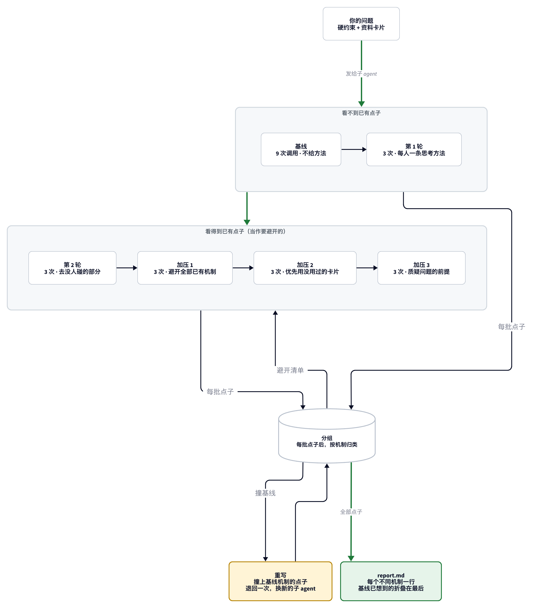
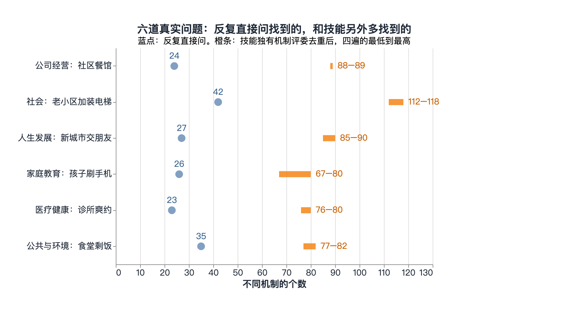
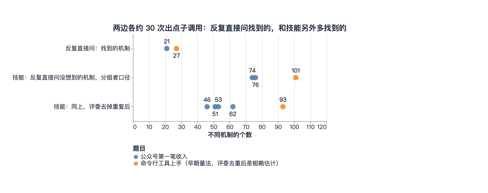
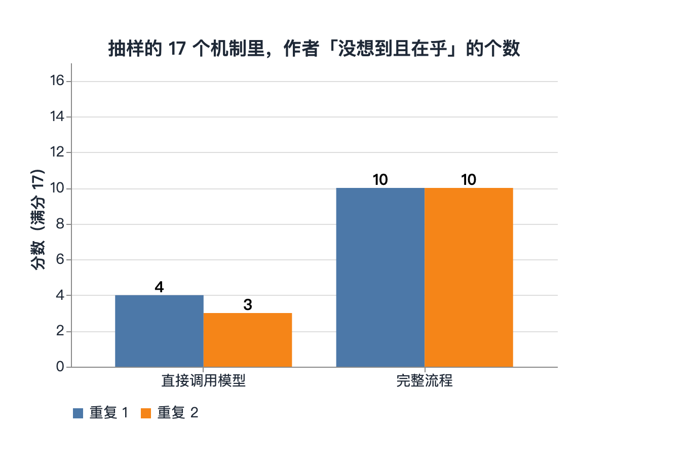
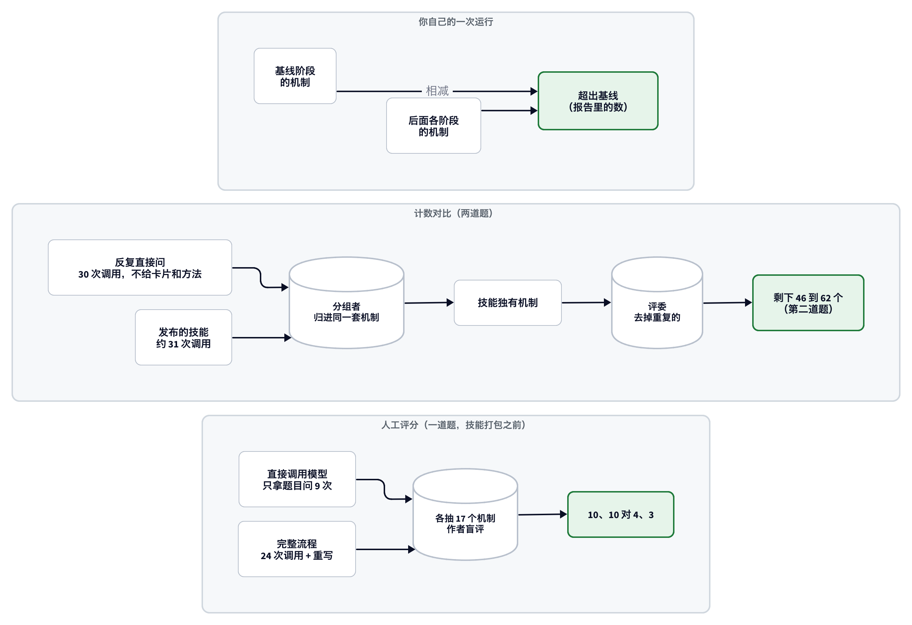
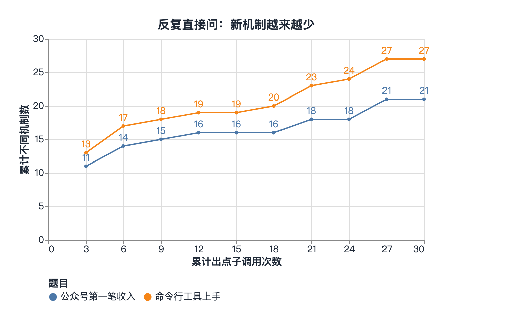
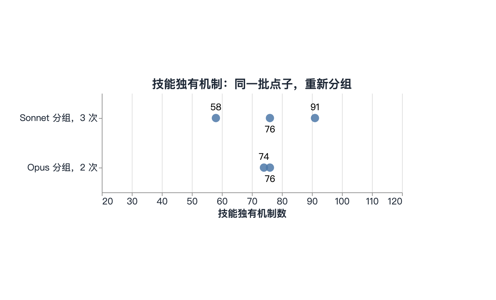
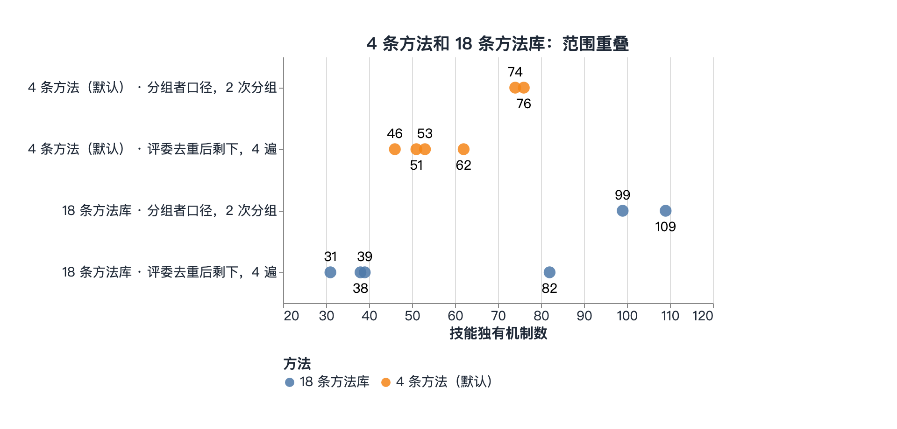

# brainstorm（头脑风暴）

[English](README.md)

头脑风暴：先把点子撑开，再谈好坏。这一页写给人看。给 agent 读的指令在 [SKILL.md](SKILL.md)。

这一页分四部分：

1. [方法论](#一方法论)：它怎么让点子不撞车。
2. [用了技能之后的提升](#二用了技能之后的提升)：和不用技能比，多出什么、花多少。
3. [典型案例](#三典型案例)：八道开放问题上，只有技能想到的点子。
4. [做过的实验和结论](#四做过的实验和结论)：每次测量量了什么、结论是什么、哪里不可靠。

## 一、方法论

### 核心想法

同一个模型被反复问同一个问题，会一直落回差不多的几类答案。这个技能做三件事，把答案推开：

- **隔离**：问题发给很多互相看不到对方的子 agent。
- **给不同的起点**：每个子 agent 拿到不同的思考方法和不同的资料卡片。
- **点名要避开的**：从第 2 轮起，子 agent 能看到已有的点子，但它们是「要避开的」，不是「可以模仿的」。

脚本按机制（点子靠什么起作用）把点子归类。你拿到每一个不同的机制；第一阶段不给方法就已想到的那些，折叠放在最后。

它只发散。它不打分、不排序、不删点子；挑选是你的事。

### 一次运行怎么走

| 阶段 | 出点子调用 | 子 agent 被告知什么 | 它能看到哪些已有点子 |
|:---|---:|:---|:---|
| 基线 | 9 | 问题、硬约束和卡片。不给方法 | 看不到 |
| 第 1 轮 | 3 | 同上，每个 agent 多一条思考方法 | 看不到 |
| 第 2 轮 | 3 | 同上，再加：去探索问题里还没人碰的部分 | 每个已有机制一个点子，要求避开；之前的 agent 怎样拆这个问题；独占一个机制的点子的标题，当起点用 |
| 加压 1 | 3 | 避开到目前为止的全部机制 | 同样三样东西，更长了 |
| 加压 2 | 3 | 优先用还没有 agent 拿到过的卡片 | 同上 |
| 加压 3 | 3 | 质疑问题本身的前提 | 同上，再加每种拆法被用了多少次 |

- **前两个阶段故意看不到已有点子**：这样能得到几份互不影响的起点。
- **从第 2 轮起，已有点子作为「要避开的」给出**，不是作为可以模仿的例子。
- **撞上基线机制的点子退回一次**：基线之后的每个阶段，脚本把这类点子和避开清单交给一个新的子 agent（方法和卡片不变）重写。这些重写就是表里 24 次之外的调用：每个阶段最多 3 次，第二次计数的那次运行里是 7 次。
- **加压 2 很少真有新卡片可给**：基线的 9 个 agent 各拿一半卡片，所以 10 张卡片通常在加压 2 之前就全被拿过了，这一级的 agent 拿到的是用过的卡片。
- **分组**：每一批新点子之后（基线有三批），以及每个阶段的重写之后，由一个子 agent 按机制分组。第二次计数的那次运行里是 12 次分组调用。分组只合并，每个点子在报告里都看得到。

### 思考方法

思考方法是数据，不是代码。默认 4 条：从不相关的领域借做法、把一个前提反过来、站在受影响最大的人的位置、用上手头闲置的资源。更大的一套 18 条在 [methods/library.jsonl](methods/library.jsonl)（`--methods library`），你可以往里加一行，也可以传自己的文件。更大的这套目前没有看出增益（见第四部分）。

方法原文是英文。2026-11-16 之前的全部测量用的是同样意思的中文原文。英文原文在第二道题上量过一次，数字比中文那次低（见第四部分「中文方法原文对英文方法原文」）；只跑了一次，还分不清是语言的影响还是运行之间的波动。子 agent 仍然用问题的语言作答。

### 什么时候用、怎么用

- **用在开放问题上**：你想要自己没想到的选项。
- **不用在这些事上**：在已知选项里做选择、修 bug、只要几条点子的快速清单。
- **它很贵**：第二次计数的那次运行用了 31 次出点子调用和 12 次分组调用，共约 43 次子 agent 调用。脚本在最贵的部分之前会停下来问你。

让你的 agent 对一个问题做头脑风暴。手上有笔记或资料就一起给它：agent 把资料切成卡片，每个子 agent 随机拿到一半。开跑前，agent 会打开一个本地评审页。你在上面改 agent 写好的问题草稿，决定它建议的硬约束（任何点子都不能违反的事）留还是去，读一遍卡片，勾选思考方法（默认勾上测过的四种），再选模型。页面会列出你的选择和测量设置有哪些不同。你点「确认开跑」之前，什么都不会跑。

跑完你拿到 `report.html`：顶部有一个链接，回到你确认过的开跑设置；下面是按主题分组的机制，每条有短标题和一句话概要，点开看完整点子。值得细看的可以加星，再导出。`report.md` 是同样内容的文本版。两个页面都有中文和英文。

两种档位：**full**（默认）跑上表的全部阶段，下面的测量量的就是它；**economy** 在第 2 轮后停止，更便宜，没有单独测过。

## 二、用了技能之后的提升

### 一句话版本

- **六个方向的真实难题上，它都想到了反复直接问想不到的机制**：社会、公司经营、人生发展、家庭教育、医疗健康、公共与环境各一道。调用次数相同时，反复直接问找到 23 到 42 个机制，技能另外多出 67 到 118 个（评委去重后）。
- **六道新题上作者快速盲评了 84 个机制**：两边单个点子的质量差不多。技能独有的 42 个里 33 个「没想到且值得试」，反复直接问的 42 个里 31 个。技能多出来的主要是数量。
- **作者盲评，它多出一倍多「没想到且在乎」的点子**：只做过一道题。每次重复抽 17 个机制，完整流程是 10 个和 10 个，直接调用模型是 4 个和 3 个。
- **同样的调用次数，它想到反复直接问想不到的机制**：在认真量过的那一道题上，反复直接问一共找到 21 个机制，技能另外多找到 46 到 62 个（中文方法原文）。现在发布的英文方法原文量过一次，多找到 33 到 39 个。
- **代价是钱**：人工评分那次，完整流程出点子的成本约是直接调用模型的 28 倍。

| | 不用技能 | 用技能 |
|:---|:---|:---|
| 作者盲评：17 个里「没想到且在乎」的 | 4、3 | 10、10 |
| 同样约 30 次调用，找到的不同机制（第二道题，中文方法原文） | 21 | 另外多出 46 到 62 |
| 同上，现在发布的英文方法原文 | 21 | 另外多出 33 到 39 |
| 六道新题，同样约 30 次调用（英文方法原文） | 23 到 42 | 另外多出 67 到 118 |

| 出点子的成本（人工评分那次） | 1 倍 | 约 28 倍 |

### 提升从哪来

人工评分那次，完整流程里作者判为「没想到且在乎」的机制，两次重复合计 18 个。按每个机制最早出自哪个阶段数：

| 最早出自 | 基线 | 第 1 轮 | 第 2 轮 | 加压 1 | 加压 2 | 加压 3 |
|:---|---:|---:|---:|---:|---:|---:|
| 机制数 | 3 | 3 | 2 | 4 | 3 | 3 |

- **一半以上来自能看到避开清单的阶段**：第 2 轮和三级加压合计 12 个。
- **这不是对单个阶段的证明**：没有哪一步被去掉后重新量过（见第四部分）。

### 要打的折扣

- **「不同」不等于「有用」**：计数数的是不同机制的个数。有用与否只有人工评分那一道题。
- **计数八道；完整的人工评分一道，快速盲评六道**：快速盲评每道题只抽 14 个机制，作者也不是这些领域的行家。
- **每道题每边只跑了一次**：同一道题跑两次差多少，没有测。
- **六道新题的资料卡片是 AI 起草的**，没有查资料核对，也没给作者看过。

## 三、典型案例

下面的点子都原样取自真实运行，没有改写过意思，只压成了一句话。完整原文和挑选规则在 [`2026-11-16-cases.json`](../../evals/brainstorm/results/2026-11-16-cases.json)。

### 命令行工具上手：作者盲评过

**问题**：一个个人维护的开源命令行工具，怎样降低新用户第一次上手就失败的比例？硬约束：不加遥测；维护者每周只有 2 小时。

**挑选规则**：作者判为「没想到、在乎、没有致命理由」，并且直接调用模型的点子一个都没落进这个机制。符合的有 14 个，下面是其中 6 个。作者对这 6 个全都答了「想试」。

| 点子 | 怎么做 | 出自 |
|:---|:---|:---|
| 学 AED 语音引导：`tool next` | 除颤器不指望人读说明书，只说下一步。工具读本机真实状态，只输出此刻唯一该做的一件事和对应命令；所有报错末尾都加一句「不知道下一步？运行 tool next」 | 加压 2 借别的领域；加压 3 站在用户位置 |
| 学编译器报错 | 报错不指向工具内部的调用栈，而是回显用户的输入，用 `^^^` 标出出错的那一处，并给出合法写法的小例子 | 加压 1 反转前提 |
| issue 表单触发自动复现 | 表单固定系统、shell、安装渠道、版本四个字段；维护者打标签后，CI 在对应的系统和 shell 上按官方命令装一遍，把复现结果贴回 issue | 加压 3 用闲置资源 |
| 防止同名程序抢占 | 发布前查包管理器里有没有重名；`--version` 固定输出「名称 版本 项目地址」；安装脚本最后检查 PATH 上是否有别的同名程序 | 加压 1、加压 3 |
| 仓库 About 一行才是第一屏 | 很多人在打开 README 之前只看到搜索结果里的一行简介。把它写成「用途、支持的系统、安装命令」，社交预览图上也写这条命令 | 加压 1 站在用户位置 |
| 先读同类工具的失败 | 自己的 issue 太少，就定期去同类工具的 issue 区搜安装类失败，逐条问「我的工具会不会也这样」，会就加成一项检查 | 加压 3 用闲置资源 |

### 公众号第一笔收入：评委判过，作者没评过

**问题**：一个人运营的中文技术公众号，怎样在三个月内拿到第一笔收入？硬约束：每周投入不超过 5 小时；不卖课，不建付费群。

**挑选规则**：技能独有、并且评委两遍都没判为「和反复直接问重复」的机制。符合的有 70 个，下面是其中 6 个。作者没有给这道题打过分，所以这些只说明「反复直接问没想到」，不说明「好」。

| 点子 | 怎么做 | 出自 |
|:---|:---|:---|
| 学合同能源管理：云账单节省分成 | 帮小团队看脱敏账单，给出两三项改动由对方执行；以改动前三个月平均为基线，只从实际省下的钱里按比例分成，不省不收 | 加压 2 借别的领域 |
| 替工具方测 AI 助手答错了什么 | 拿评论区读者真实问过的问题去问主流 AI 助手，对照官方文档标对、错、过时，交一页错答清单和该补的文档页，按份收费 | 加压 3 反转前提 |
| 国内网络可达性实测 | 用自己的安装检查脚本，在家用宽带和手机热点下实测海外工具的下载和安装，给出海工具方按份出报告 | 加压 3 用闲置资源 |
| 发布前替科技号挑技术错误 | 不懂技术的科技自媒体和企业号，发稿前 24 小时内拿到一页「技术错误和改法」，按稿固定价 | 加压 3 站在受影响的人的位置 |
| 学期刊客座主编 | 替厂商的开发者博客或社区组一期专刊：约稿、统一体例、校一轮，按期收组稿编辑费，自己不写其中任何一篇 | 加压 2 借别的领域 |
| 脚本独占窗口竞价 | 一个常被问的脚本不公开源码，出价最高的一家公司独占六个月，到期后公开 | 加压 3 用闲置资源 |

### 六个方向的新题：评委判过，作者没评过

**挑选规则**：评委两遍都没判为「和反复直接问重复」的技能独有机制，每道题挑 2 个。作者没给这些题打过分。

| 方向 | 点子 | 怎么做 | 出自 |
|:---|:---|:---|:---|
| 公司经营 | 结账时问一句「家里要不要带一份」 | 外卖被抽成，就让已经在店里的客人顺手带走第二份。按店里的价，不走平台，没有佣金 | 加压 1 反转前提 |
| 公司经营 | 学汽车「平台化」设计菜单 | 让十来道热销菜共用五六种底料和浇头，每种原料的用量变大，拿合并后的量去和供应商谈价 | 加压 2 借别的领域 |
| 社会 | 一楼签字才放款 | 自筹款存进托管账户，按施工阶段分笔拨付；每一笔都要一楼住户确认上一阶段的承诺兑现了，一楼从被通知的一方变成握着闸门的一方 | 加压 2 用闲置资源 |
| 社会 | 学剧院「视线受限座位」折价 | 把每户受的影响（遮挡、通道变窄、还要走几级台阶）分级，事先公示折价表，各户出资折扣由表自动算出，不用逐户谈补偿 | 加压 2 借别的领域 |
| 人生发展 | 替有家庭的同龄人看家 | 对方出门时免费帮着喂猫浇花。交出钥匙本身就是一次深度信任，不占对方的晚上，也不用谁先发起邀约 | 加压 1 用闲置资源 |
| 人生发展 | 极端天气夜的问候 | 台风、停电、暴雪的夜里全城都醒着，给第一个深夜电话一个谁都懂的理由；平时建一个只在这种夜里说话的小群 | 加压 2 用闲置资源 |
| 家庭教育 | 家长先撤一条旧规 | 每月公开取消一条自己立过、孩子最反感的规矩，说明不是交换；再请孩子自己提一个手机上的小调整，做不做由孩子定 | 加压 2 用闲置资源 |
| 家庭教育 | 和好朋友交换限额密码 | 孩子和信任的朋友各自用手机自带功能设娱乐上限，把解锁密码交给对方保管；执行者从家长换成同伴 | 加压 3 站在孩子的位置 |
| 医疗健康 | 天气预警前替老人顺延 | 暴雨、寒潮预警一发，系统给次日的老年患者留好后天同一时间的号，点一下就换，不点照常；不来的号立刻放给候补 | 加压 1 站在患者的位置 |
| 医疗健康 | 发现患者同天约了大医院 | 区域预约平台里同一手机号同天有别家医院的号，就主动提示改期；患者多半会去大医院，社区的号原本会悄悄作废 | 加压 1 站在患者的位置 |
| 公共与环境 | 学报童模型定备量 | 缺菜有同价替代菜补、剩菜只能整盆倒，两种损失不一样大；易坏的菜少备、耐放的多备，不再一律宁多勿少 | 加压 3 借别的领域 |
| 公共与环境 | 大米和酱油盲测 | 同一价位里换几个牌子，让学生盲测选口感最好的；几乎每道菜都沾，不改菜单、不改分量，承包方阻力也小 | 加压 3 反转前提 |

### 看案例时要知道

- **案例是挑出来的**：挑选的是写这一页的 AI 助手，不是随机抽样。随机抽样的结果见第四部分的人工评分。
- **第一道题的案例来自技能打包之前的完整流程**，提示词和发布的技能相同，跑法不同（见第四部分）。
- **24 个案例全部出自加压阶段**：这和第二部分的分布一致，但挑选本身有偏差，不能当证据。
- **六道新题的案例只说明「反复直接问没想到」**，不说明「好」。

## 四、做过的实验和结论

### 全部测量一览

R = [evals/brainstorm/results](../../evals/brainstorm/results/)，那里的 README 逐个说明每个文件。

| 日期 | 题目 | 比的是什么 | 怎么量的 | 结论 | R 里的文件 |
|:---|:---|:---|:---|:---|:---|
| 11-08 | 命令行工具上手 | 技能打包之前的完整流程，对直接调用模型 | 作者盲评，每次重复 17 个机制 | 完整流程「没想到且在乎」的多一倍多 | `2026-11-08-human-scored-cli.json` |
| 11-12 | 命令行工具上手 | 发布的技能、反复直接问 | Sonnet 分组一次；评委抽查 25 个 | 技能多出很多机制；量法粗糙，只能粗看 | `2026-11-12-equal-calls-cli.json` |
| 11-13 | 公众号第一笔收入 | 发布的技能、反复直接问 | Sonnet 分组一次；评委抽查 25 个 | 计数被 11-14 的量法替换；两次运行本身仍在用 | `2026-11-13-equal-calls-side-income.json` |
| 11-13 | 公众号第一笔收入 | 用 18 条方法库的技能 | Sonnet 分组一次 | 被最后一行替换 | `2026-11-13-method-library-side-income.json` |
| 11-14 | 公众号第一笔收入 | 同一次技能运行，重新分组 | Sonnet 三次，Opus 两次 | 分组模型越强越稳；之后一律用最强模型分两次 | `2026-11-14-grouper-repeat-side-income.json` |
| 11-14 | 公众号第一笔收入 | 4 条方法、18 条方法库 | Opus 分组两次；评委查全部机制，各两遍 | 方法库没有增益的证据，默认仍是 4 条 | `2026-11-14-methods-default-vs-library-side-income.json` |
| 11-16 | 公众号第一笔收入 | 英文方法原文、中文方法原文 | Opus 分组两次；评委查全部机制，各两遍 | 英文这次每个数都更低；每边只跑一次，分不清是语言还是波动 | `2026-11-16-english-methods-side-income.json` |
| 11-16 | 六个方向各一道新题 | 发布的技能（英文方法原文）、反复直接问 | 每道题 Opus 分组两次；评委查全部机制，各两遍；另一个模型抽查 | 六道题上技能都多出很多机制；抽查没发现评委放水 | `2026-11-16-six-questions.json` |
| 11-16 | 六道新题 | 技能独有机制、反复直接问的机制 | 作者快速盲评，每道题 14 个，共 84 个 | 「没想到且值得试」两边差不多；技能强在数量 | `2026-11-16-blind-six.json` |
| 11-16 | 八道题 | 典型案例 | 从上面的运行里按规则挑选 | 只是展示，不是测量 | `2026-11-16-cases.json` |

### 这里用到的词

- **机制**：点子靠什么起作用。两个点子机制相同，只算一个。
- **基线**：一次技能运行的第一个阶段。给卡片，不给方法。你的报告折叠的就是它想到的机制。
- **反复直接问**：只为测量另外做的一次对照运行。同一个问题一遍遍地问，不给卡片、不给方法、不分轮，出点子调用次数和技能相同。它不是基线。
- **完整流程**和**直接调用模型**：人工评分那次比的两边，都在技能打包之前用直接的模型调用跑的。完整流程有第一部分表里的各个阶段。直接调用模型是只拿题目问 9 次：不给卡片、不给方法、不分轮。
- **分组者**：把点子归进机制的模型。做对比时，先给反复直接问的点子分组，再把技能的点子归进这些机制或新机制。
- **技能独有机制**：里面有技能运行的点子、没有反复直接问的点子的机制。
- **超出基线**：你自己那次运行报告的数。它比的是那次运行自己的基线，所以不是技能独有的数。两次计数的运行里它都更大（112 和 107）。
- **评委**：和分组者不同的另一种模型。它读技能独有机制，指出哪些和反复直接问的机制重复。它也查硬约束。
- **一遍**：评委完整读一次。

### 有人工评分的部分：只有一道题

比的是技能打包之前的「完整流程」和直接调用模型。两边都直接调用 Sonnet，不带工具。

| | 直接调用模型 | 完整流程 |
|:---|---:|---:|
| 每次重复的出点子调用 | 9 | 24，另加 4 次和 7 次重写 |
| 每次重复的点子数 | 90、90 | 233、247 |
| 每次重复的机制数 | 21、23 | 123、133 |
| 每次重复给作者看的机制数 | 17 | 17 |
| **分数，两次重复** | **4、3** | **10、10** |
| 17 个里「之前没想到」 | 4、3 | 10、11 |
| 17 个里「我在乎」 | 16、16 | 16、15 |
| 出点子的成本，两次重复合计 | 0.25 美元 | 7.03 美元 |

- **怎么评的**：每次重复按一个固定种子的顺序抽 17 个机制。每个机制展示成一个点子，改写成大白话，页面上没有任何来源信息。作者答完全部题目之后才揭晓来源。一个机制得分的条件是：作者之前没想到、在乎它、没有写致命理由。
- **分差从哪来**：全部来自「之前没想到」。「我在乎」两边一样。
- **17 个只是完整流程的一小部分**：直接调用模型的 21 或 23 个机制里抽了 17 个，完整流程的 123 或 133 个机制里也只抽 17 个。所以分数比的是「抽样里有多大比例是作者没想到的」，不是「两边各找到多少新机制」。
- **两次重复不独立**：直接调用模型的两次重复在 17 个里有 13 个相同；相同的机制只评一次，分数记给两边。
- **盲评不彻底**：按作者的说法，从文字长度和方法腔能看出点子来自哪个流程。
- **没有查硬约束**：没有评委检查那些点子是否违反题目的硬约束。
- **对比不对等**：直接调用模型没给卡片；完整流程的成本约为它的 28 倍（两次重复分别是 22 倍和 36 倍），还没算分组的成本。
- **只有一种跑法，而且不是发布的那种**：评分的流程直接调用模型。本技能里由你的 coding agent 派发子 agent，提示词相同，出点子调用同样是 24 次，但它只有下面的计数，没有人工评分。

### 和反复直接问比计数：两道题各跑一次

发布的技能和反复直接问并排跑，两边各约 30 次出点子调用。两边出点子的都是 coding agent 派发的 Sonnet 子 agent。这些运行没有人工评分。

| | 命令行工具上手 | 公众号第一笔收入 |
|:---|---:|---:|
| 反复直接问：调用 / 点子 / 机制 | 30 / 300 / 27 | 30 / 293 / 21 |
| 技能：调用 / 点子 | 31 / 252 | 31 / 258 |
| 给反复直接问的点子分组的 | Sonnet | Sonnet |
| 给技能的点子分组的 | Sonnet，一次 | Opus，两次 |
| 分组者口径的技能独有机制 | 101 | 76 和 74 |
| 评委 | Opus | 第三种 Claude 模型 |
| 评委查了多少 | 随机抽 25 个，一遍 | 全部，每次分组两遍 |
| 评委去重后剩下的技能独有机制 | 约 93（估计） | 53 和 62（第一次分组），51 和 46（第二次） |
| 被判违反硬约束的机制 | 128 个里 1 个 | 五遍里，95 到 97 个中有 0 到 4 个 |

- **第二道题是认真量过的**：46 到 62 这个范围来自两次分组和四遍评委。
- **第一道题用的是早期的量法，没有重做**：一次 Sonnet 分组和抽 25 个都已知不稳（见下一节），101 和 93 只能粗看。
- **反复直接问很早就变慢，但没有停**：27 个机制里的 18 个、21 个里的 15 个出自前 9 次调用。两道题的第 25 到 27 次调用都还新增了 3 个。
- **被判违规的全是同一种**：超出题目设定的每周时间上限。这是从评委的回答里读出来的，结果文件只记了个数。
- **查硬约束不是盲的**：评委拿到的清单没有标来源，但从提示词的另一半能推出来源。
- **调用次数相同，token 不同**：技能后几步的提示词长得多。
- **作者看过一次**：作者从第一道题的技能独有机制里随机抽 10 个看过，说其中七八成会去尝试（整体印象，没有逐条标注）。
- **第一次技能运行丢了 31 次出点子调用里的 2 次**（两个重写任务），原因是宿主出错。
- **只有一个模型家族**：出点子的、分组者、评委全是 Claude 模型。

### 量具有多稳

在第二道题上量的，点子不变。

| 重复了什么 | 结果 |
|:---|:---|
| Sonnet 分组，三次 | 技能独有机制 91、76、58 个；84% 到 91% 的点子判定一致 |
| Opus 分组，两次 | 76 和 74 个；96% 的点子判定一致 |
| 评委在两次分组上各抽查 25 个（这两次分组对 96% 的点子判定一致） | 判 5 个和 16 个重复 |
| 评委把默认运行的全部机制查两遍 | 76 个里 67 个同判，74 个里 65 个同判 |
| 评委把方法库运行的全部机制查两遍 | 99 个里先判 17 个重复，再判 60 个 |

- **更强的分组者更稳**：评测现在用手头最强的模型分组，并且分两次。
- **抽 25 个太少**：评测现在查全部技能独有机制，并且让评委判两遍。
- **评委是最不稳的一环**：两次运行之间的差别，要大于评委对同一次运行判两遍的差别，才算数。

### 4 条方法对 18 条方法库

在第二道题上用 `--methods library` 跑了一次，和默认运行对比。两边都对着同一次反复直接问，由 Opus 分组两次；评委把每次分组里的全部技能独有机制查两遍。

| | 4 条方法（默认） | 18 条方法库 |
|:---|---:|---:|
| 出点子调用 | 31 | 29 |
| 用到的方法 | 4 条里的 4 条 | 18 条里的 15 条 |
| 技能点子 | 258 | 246 |
| 分组者口径的技能独有机制，两次分组 | 76、74 | 99、109 |
| 评委去掉重复后剩下的，四遍 | 53、62、51、46 | 82、39、31、38 |

- **分组者给方法库数得更多，评委去掉的也更多**：四遍里有三遍方法库低于默认方法，一遍高于。
- **所以没有增益的证据，也不能证明更差**：默认仍是 4 条方法。
- **每边只跑了一次**：再跑一次技能会差多少，没有测。

### 六个方向的新题：每道题各跑一次

| 题目 | 反复直接问的机制 | 分组者口径的技能独有机制，两次分组 | 评委去重后剩下的，四遍 | 两次分组判定一致 | 抽查 15 个判为重复 |
|:---|---:|---:|---:|---:|---:|
| 社区餐馆（公司经营） | 24 | 92、92 | 89、89、89、88 | 99% | 0 |
| 老小区加装电梯（社会） | 42 | 126、125 | 116、118、113、112 | 97% | 0 |
| 新城市交朋友（人生发展） | 27 | 92、94 | 85、85、88、90 | 97% | 1 |
| 孩子刷手机（家庭教育） | 26 | 83、85 | 73、76、67、80 | 98% | 2 |
| 诊所爽约（医疗健康） | 23 | 90、90 | 79、76、76、80 | 96% | 0 |
| 食堂剩饭（公共与环境） | 35 | 86、88 | 79、77、82、81 | 94% | 1 |

- **问题和硬约束**：见 [`2026-11-16-six-questions.json`](../../evals/brainstorm/results/2026-11-16-six-questions.json)，里面也有每道题的 10 张资料卡片。
- **怎么量的**：和第二道题同一套量法。技能用现在发布的英文方法原文；反复直接问 30 次调用，技能 29 到 35 次。
- **抽查**：每道题从评委两遍都保留的机制里随机抽 15 个，交给另一个模型按同一条规则重判。90 个里只判出 4 个重复，所以评委在新题上没有明显放水。
- **为什么比公众号那道题高得多**：[推断：依据是两边点子的分布，没有单独实验] 公众号收入的点子都落在少数几种挣钱方式上，反复直接问很快就覆盖了；新题的解法空间大得多。
- **诊所题的第二次分组有 13 个技能独有机制没被分组者处理**：它们各自算一个机制，可能抬高了那一份的计数。另一份分组没有这个问题，两份结果接近。
- **资料卡片是 AI 起草的**：没有查资料核对，作者也没看过。
- **只有一个模型家族**：出点子的、分组者、评委、抽查者全是 Claude 模型。

### 六道新题的快速盲评

每道题随机抽 7 个技能独有机制（评委两遍都保留的）和 7 个反复直接问的机制，打乱后不标来源，共 84 个。每个机制统一改写成一句标题加一两句说明，去掉方法腔。作者每个只按一次键。

| 作者的回答 | 技能独有 | 反复直接问 |
|:---|---:|---:|
| 没想到，值得试 | 33 | 31 |
| 想到过，值得试 | 2 | 8 |
| 不值得试 | 7 | 3 |
| 看不懂 | 0 | 0 |

- **「没想到且值得试」两边差不多**：42 个里 33 个对 31 个。
- **技能的点子更少是作者想到过的，但「不值得试」也多一些**：2 对 8、7 对 3。每边只有 42 个，这两个差别都可能是偶然（双侧 Fisher 检验 p 约 0.09 和 0.31）。
- **和命令行那道题不同**：那道题作者是行家，反复直接问的点子大多想到过；这六道题作者多半不是行家，所以两边的点子大多都是新的。
- **怎么读**：单个点子，技能的不比反复直接问的好；技能的长处是数量，同样的调用次数多出约三倍的机制。
- **盲度**：改写后两边正文平均 62.1 字对 61.8 字，页面里没有来源标记。改写时为压到 70 字删掉了一些次要步骤。
- 数据：[`2026-11-16-blind-six.json`](../../evals/brainstorm/results/2026-11-16-blind-six.json)。

### 中文方法原文对英文方法原文

2026-11-16 起方法原文改成英文。在第二道题上用同样的卡片、同样的随机种子、同一次反复直接问重跑了一次，按 11-14 的量法量：Opus 分组两次，评委把全部技能独有机制各查两遍。子 agent 的点子仍然全是中文。

| | 中文方法原文 | 英文方法原文 |
|:---|---:|---:|
| 这次运行的出点子调用 | 31 | 33 |
| 这次运行的点子 | 258 | 274 |
| 分组者口径，两次分组 | 76、74 | 47、62 |
| 评委去重后，四遍 | 53、62、51、46 | 36、39、33、35 |

- **英文这次的每个数都更低**：四遍评委结果全部低于中文那次的最低值。
- **但每边只跑了一次**：同样的原文跑两次会差多少，从来没测过。所以这不能证明英文原文更差。
- **这次两次分组的一致率更低**：85% 的点子判定一致，中文那次是 96%。评委反而更稳：两遍在 47 个里有 42 个同判，62 个里有 58 个同判。

### 还不知道的事

- 换别的题目结论是否成立：计数做过八道题，技能都多出很多机制；人工评分只做过一道，新题的点子好不好没人评过。
- 同一道题跑两次技能会差多少。所以也不知道英文方法原文那次偏低，是语言造成的还是波动。
- 哪些步骤值它的成本。没有哪一步被去掉后重新量过。
- 多想到的那些机制有没有用：完整评分一道题，快速盲评六道题。快速盲评里技能独有的点子和反复直接问的一样常被判「值得试」，但样本小，作者也不是行家。
- 不给卡片，或者让 agent 自己搜集卡片时效果如何。每次量过的运行都用了作者事先写好的 10 张卡片。
- 换别的模型效果如何。出点子的、分组者、评委全是 Claude 模型。

数据见 [evals/brainstorm/results](../../evals/brainstorm/results/)。工具和怎样重做这次对比见 [evals/README.md](../../evals/README.md)。
