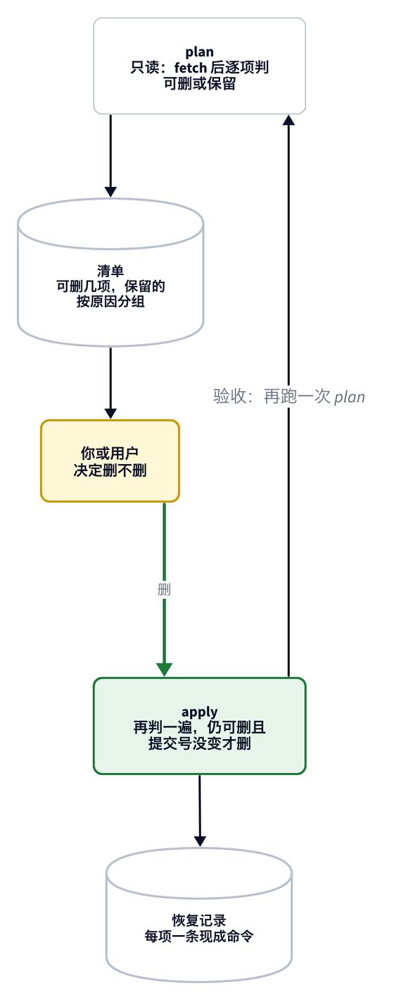
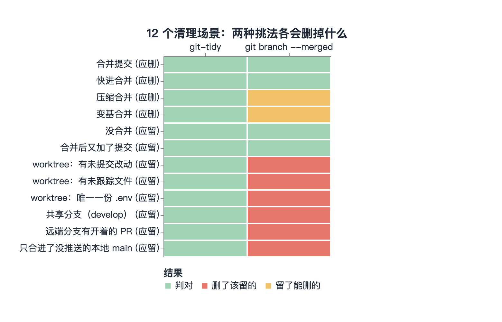

# git-tidy

[English](README.md)

清理做完的 worktree、本地分支和远端分支，只删确定不会丢东西的。压缩合并、变基合并之后提交号全变了，它也认得出分支已经合进去；每一项在删之前都会再判一遍。

## 1. 什么时候用

仓库里堆了一堆做完的 worktree 和分支时用：「清理一下已合并的分支」「worktree 太多了」「远端分支清一清」。它管的是整体清理，不是删一个点名的分支。

特别适合让 coding agent 每个任务开一个 worktree 的仓库。这类 worktree 堆得快，里面常有 git 忽略的文件（工具状态、`.env`），合并又常用压缩合并，常见的 `git branch --merged` 看不出来。

## 2. 怎么工作



`plan` 只读。先 fetch，再把每个 worktree 和分支判成可删（SAFE）或保留（KEEP），写明原因。agent 把可删几项、保留的按原因分组告诉你。`apply` 重新 fetch、重新判，只删仍然可删、而且还指向同一个提交的项。每次删除都写进恢复记录，每项一条现成的恢复命令。

一项要同时满足两件事才可删：代码已经在主干里（`origin/HEAD`，不是你本地的 main），删了不丢东西。

| 检查 | 什么情况保留 |
|:---|:---|
| 代码在不在主干 | 有任何改动主干里没有。四种判法由便宜到贵：是主干的祖先；合进主干不产生改动；每个提交在主干有等价补丁（变基合并）；整支压成一个补丁后在主干有等价提交（压缩合并） |
| worktree 里的东西 | 有未提交改动、未跟踪文件，或不是可再生缓存的被忽略文件 |
| 有没有在用 | 有进程的当前目录在里面，或最近 12 小时有 git 活动，或 worktree 被锁定 |
| 共享分支 | main、master、develop、release 系列这类名字永远不删 |
| 远端分支 | 有开着的拉取请求（或查不到状态），或最新提交不是你写的 |

还有用的被忽略文件（比如 `.env`）可以登记成删前转移（`git config --add git-tidy.salvage '.env'`）；可以丢的登记成可丢。

## 3. 证据

12 个场景，每个都在一次性的临时仓库里搭出来，正确答案由搭法决定。同一批场景分别交给 git-tidy 和常见清理做法的挑选那一步：`git branch --merged`（远端分支用 `git branch -r --merged`），排除 main 和 master。



| | 删了该留的 | 留了能删的 |
|:---|:---:|:---:|
| git-tidy | 8 个里 0 个 | 4 个里 0 个 |
| `git branch --merged` | 8 个里 6 个 | 4 个里 2 个 |

常见做法认不出压缩合并和变基合并；还会挑中共享的 `develop`、有开着拉取请求的分支、只合进了没推送的本地 main 的分支，以及已合并分支的 worktree，不管里面有什么。

结果文件：[`evals/git-tidy/results/2026-11-23-scenarios.json`](../../evals/git-tidy/results/2026-11-23-scenarios.json)。重跑：`python3 evals/git-tidy/run_scenarios.py`。

## 4. 局限

- 场景是作者按已知风险一类一个写的。它们说明规则按设计工作，不说明这些情况在真实仓库里有多常见。
- 对比的是「挑哪些删」。常见做法挑错的 6 个里，有 2 个 git 自己的 `git worktree remove` 不带 `--force` 也会拒绝（有未提交改动、有未跟踪文件）。唯一一份 `.env` 被忽略的那个 worktree 它不会拒绝：那个文件会被悄悄删掉。
- 评测里关掉了「12 小时内有活动」这条，因为每个场景的仓库都是刚建的。
- 判断「有进程在用这个 worktree」需要 `lsof` 或 `/proc`，两个都用不了时所有 worktree 一律保留。
- 它是一个脚本加给 agent 的说明。删不删仍然取决于 agent 按步骤来：只有你要求清理时才 apply。

## 5. 要求与安装

Python 3.9 及以上，git 2.38 及以上（需要 `git merge-tree --write-tree`）。`gh` 可选；没有它时远端分支因为查不到拉取请求状态一律保留。

安装方法见[仓库首页](../../README.zh.md)。不经过 agent 直接用脚本：

```bash
python3 skills/git-tidy/scripts/git_tidy.py plan --repo <仓库>
python3 skills/git-tidy/scripts/git_tidy.py apply --repo <仓库>
```

测试：`python3 -m unittest discover -s skills/git-tidy/tests`。
