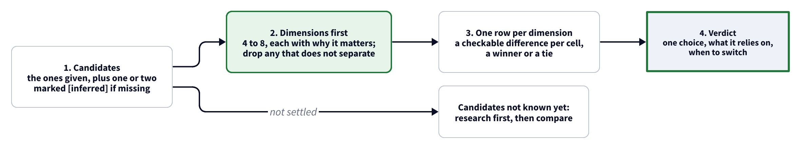
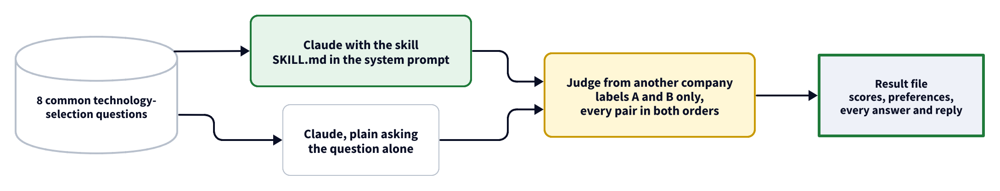
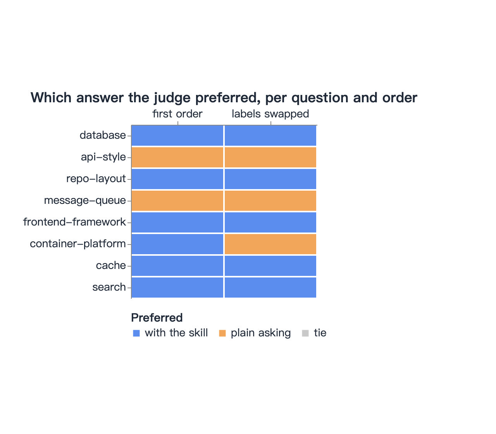
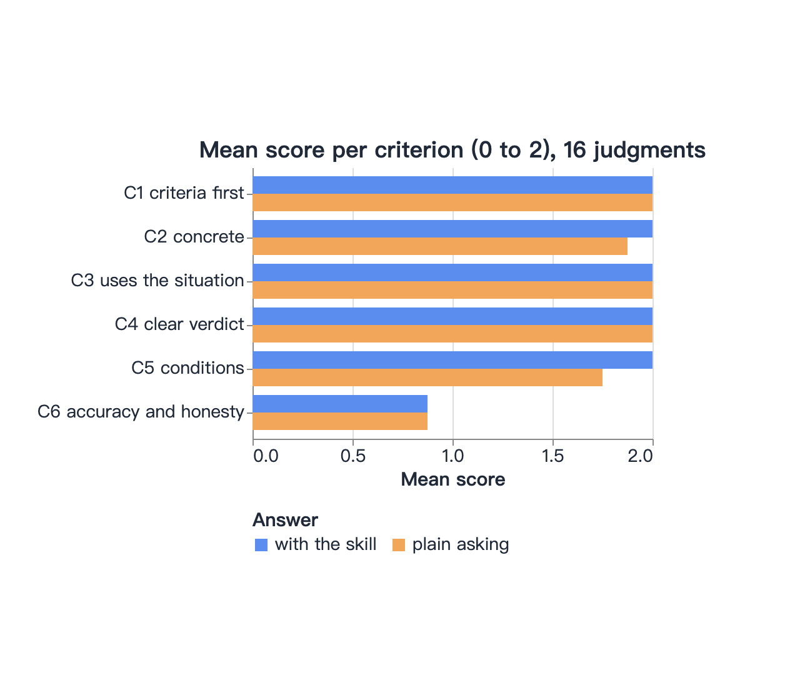

# think-compare

[中文](README.zh.md)

Helps you choose between options you already have. Before comparing anything it names the dimensions this choice turns on, then compares the options one dimension at a time with a winner per dimension, and ends with one choice, what that choice relies on, and when another option would be better. This page is for people. The instructions your agent reads are in [SKILL.md](SKILL.md).

## 1. When to use it

Use it when the candidates are already mostly known and someone has to pick one and defend the pick: "PostgreSQL or MongoDB?", "monorepo or one repository per service?", "compare ECS, EKS and a hosted platform". The skill fits technology choices, implementation paths, architecture and product decisions alike.

Do not use it:

- when the candidates are not known yet, or the question is whether something is feasible at all: research first, then compare;
- for an open topic where you want an overview of the field and no verdict;
- for a quick yes or no that needs no reasons.

## 2. How it works

1. **Candidates.** It uses the ones you gave. If the list looks incomplete it adds one or two and marks them `[inferred]`. If the candidates are not settled, it says to research them first.
2. **Dimensions first.** Four to eight dimensions taken from this question, each with why it matters here. A dimension on which the candidates do not differ is dropped.
3. **One row per dimension.** Each cell states a difference someone could check (a named feature, a limit, the operational work), not an adjective. Each row names a winner or a tie. A premise that has not been checked is marked `[unverified]`.
4. **Verdict.** One recommendation with its reasons, what it holds on, and when to choose another option instead. A tie says which piece of information would break it and which option is the safer default now.

What it is meant to prevent: picking an answer first and choosing dimensions to fit it, a list of pros and cons with no verdict, and "it depends" with nothing to act on.

## 3. Evidence

Eight common technology-selection questions, written for this evaluation (a database for a multi-tenant SaaS, REST or GraphQL, monorepo or not, a message queue, React or Vue, a container platform, Redis or Memcached, product search). Each question gives some of the facts a real team would: team skills, scale, budget, operations capacity, stated needs.

Each question was answered twice by Claude Opus 5.5 with no tools and none of the user's own setup: once with `SKILL.md` in the system prompt, once by plain asking. A judge from another company (GPT 6.1 through kilo) saw the two answers under the labels A and B only, scored each on six criteria from 0 to 2, and said which it preferred. Every pair was judged twice, the second time with the labels swapped, so 16 judgments in all.

| | With the skill | Plain asking | Tie |
|:---|:---:|:---:|:---:|
| Preferred, of 16 judgments | 11 | 5 | 0 |
| Preferred in both orders, of 8 questions | 5 | 2 | 1 question split |
| Higher total score, of 16 judgments | 6 | 1 | 9 equal |

The judge preferred label A 7 times and label B 9 times, so position did not drive the result. On three questions (database, React or Vue, Redis or Memcached) the skill answer was preferred in both orders and also scored higher in both; no question went that way for plain asking.

Mean total out of 12: **10.875** with the skill, **10.5** by plain asking. Both reach the maximum on naming criteria (C1), using the situation (C3) and giving a clear verdict (C4): plain asking with this model already compares along criteria and commits to a choice. The gap is in two places: concrete, checkable differences (C2: 2.0 against 1.875) and saying what the choice relies on and when to switch (C5: 2.0 against 1.75). Accuracy and honesty (C6) is the weakest criterion for both, 0.875 each: the skill did not reduce factual errors or unmarked assumptions.

Where plain asking won (REST or GraphQL, the message queue), the judge's reasons were the same kind: the skill answer leaned on assumptions the question did not give, such as a cost estimate built from peak traffic.

Result file: [`evals/compare/results/2026-11-24-eight-questions.json`](../../evals/compare/results/2026-11-24-eight-questions.json), with every question, answer and judge reply. How it was run and what each count means: [evals/compare/README.md](../../evals/compare/README.md).

## 4. Limits

- Eight questions, one answer per arm per question, one judge model, one run. How much the result moves between runs was not measured.
- No person has scored these answers yet. The judge's verdicts are the only scores.
- The rubric was written alongside the skill, and three of its six criteria (criteria first, clear verdict, conditions) are steps the skill asks for. A rubric that rewards other things could give a smaller gap or none.
- The rubric is near its ceiling for this model: nine of the sixteen judgments gave both answers the same total. It tells strong answers apart only on a few criteria.
- Skill answers are much longer than plain ones. The judge was told not to reward length, which cannot rule out that it did.
- All questions are technology choices. Implementation paths, architecture and product decisions were not measured.
- In the test the skill was put into the system prompt. Whether an agent picks it up on its own from the description was not measured.

## 5. Install

From the [repository root](../../README.md#install): `claude plugin install think-compare@xiaolang-skills` in Claude Code, or `./install.sh think-compare` for kilo, opencode and other agents that read `~/.agents/skills`.
