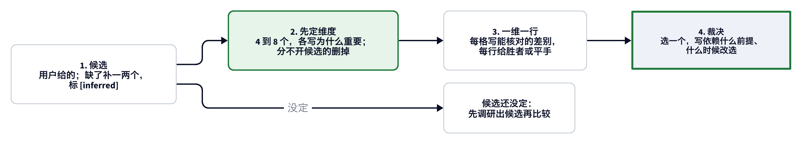
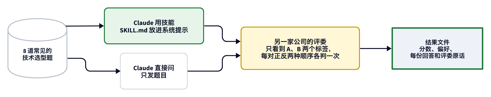
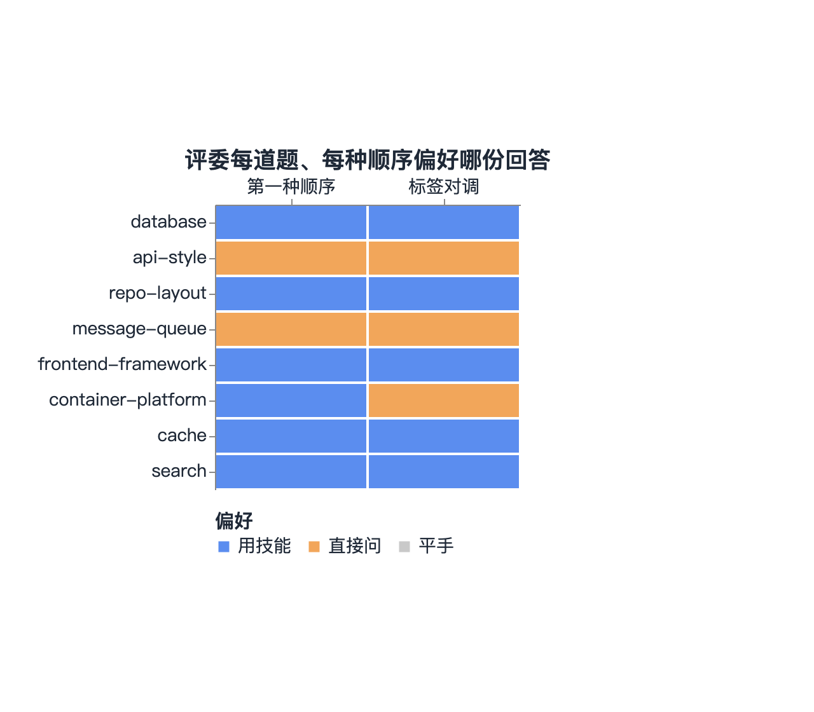
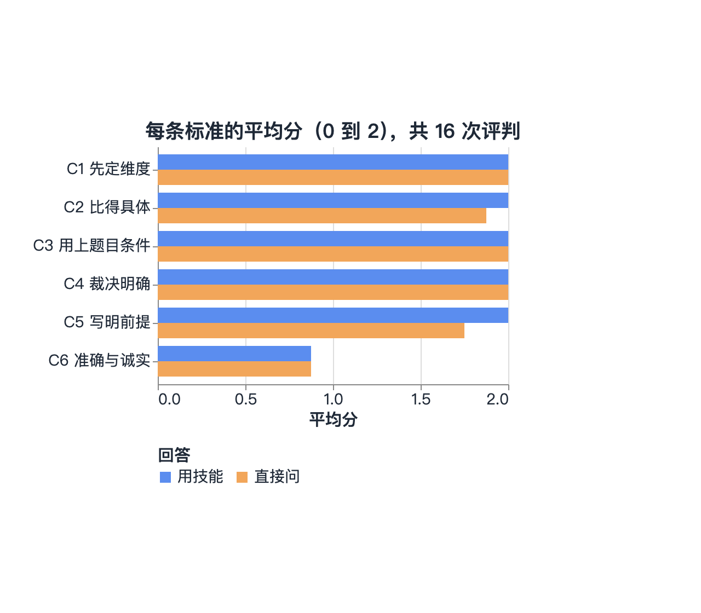

# think-compare

[English](README.md)

在已有的几个选项里帮你选一个。它先说清这次选择取决于哪些维度，再逐个维度比较、每个维度给出胜者，最后给出一个选择、这个选择靠什么前提成立、什么情况下改选别的。这一页给人看；agent 读的说明在 [SKILL.md](SKILL.md)。

## 1. 什么时候用

候选已经基本明确、有人要选一个并向团队说清理由时用：「PostgreSQL 还是 MongoDB？」「上单仓库还是一个服务一个仓库？」「比一下 ECS、EKS 和托管平台」。技术选型、实现路径、架构和产品决策都适用。

不适合用：

- 候选还不知道，或者要判断的是这事到底做不做得成：先调研，再比较；
- 开放主题，只想了解全貌、不要裁决；
- 只要一句是或否、不需要理由的问题。

## 2. 怎么工作

1. **候选。** 用你给的。清单看着不全时补一两个，标 `[inferred]`。候选还没定下来时，说明要先调研。
2. **先定维度。** 从这道题本身取四到八个维度，每个写明为什么在这里重要。几个候选在某个维度上没差别，就去掉这个维度。
3. **每个维度一行。** 每格写一个别人查得到的差别（具体功能、限制、要做的运维工作），不写形容词。每行给出胜者或平手。没核实过的前提标 `[unverified]`。
4. **裁决。** 一个推荐和理由、它靠什么前提成立、什么情况下改选别的。平手时说明哪条信息能打破平手、现在必须选的话哪个更稳妥。

它要防的是：先定答案再挑维度去凑；只列优缺点不下结论；一句「看情况」让人没法行动。

## 3. 证据

八道常见的技术选型题，为这次评测写的（多租户 SaaS 选数据库、REST 还是 GraphQL、要不要单仓库、消息队列、React 还是 Vue、容器平台、Redis 还是 Memcached、商品搜索）。每道题都给了真实团队会给的一部分事实：团队技能、规模、预算、运维能力、明确的需求。

每道题由 Claude Opus 5.5 回答两次，不带工具、不带用户自己的任何配置：一次把 `SKILL.md` 放进系统提示，一次直接问。评委来自另一家公司（GPT 6.1，经 kilo 调用），只看到标成 A 和 B 的两份回答，按六条标准各打 0 到 2 分，再说偏好哪份。每对回答评两次，第二次对调标签，一共 16 次评判。

| | 用技能 | 直接问 | 平手 |
|:---|:---:|:---:|:---:|
| 被偏好，共 16 次评判 | 11 | 5 | 0 |
| 两种顺序都被偏好，共 8 道题 | 5 | 2 | 1 道题两次不一致 |
| 总分更高，共 16 次评判 | 6 | 1 | 9 次相同 |

评委偏好标签 A 7 次、标签 B 9 次，位置没有左右结果。有三道题（数据库、React 还是 Vue、Redis 还是 Memcached）用技能的回答两种顺序都被偏好、分数也都更高；直接问没有一道题做到这一点。

满分 12 的平均总分：用技能 **10.875**，直接问 **10.5**。两边在先定维度（C1）、用上题目条件（C3）、裁决明确（C4）上都拿满分：这个模型直接问也会按维度比较并给出选择。差距在两处：比得具体、写出查得到的差别（C2：2.0 对 1.875），写明选择靠什么前提、什么时候改选（C5：2.0 对 1.75）。准确与诚实（C6）是两边最弱的一条，都是 0.875：技能没有减少事实错误和没标出来的假设。

直接问胜出的两道题（REST 还是 GraphQL、消息队列）里，评委给的理由是同一类：用技能的回答依赖了题目没给的假设，比如拿峰值流量去估月成本。

结果文件：[`evals/compare/results/2026-11-24-eight-questions.json`](../../evals/compare/results/2026-11-24-eight-questions.json)，里面有每道题、每份回答和评委的每条回复。怎么跑、每个计数什么意思：[evals/compare/README.md](../../evals/compare/README.md)。

## 4. 局限

- 八道题，每道题每种做法只答一次，一个评委模型，只跑了一轮。结果在多次运行之间波动多大，没有测。
- 还没有人给这些回答打过分。评委的判断是唯一的分数。
- 评分标准和技能是一起写的，六条里有三条（先定维度、裁决明确、写明前提）正是技能要求的步骤。换一套看重别的东西的标准，差距可能更小，也可能没有。
- 对这个模型来说评分标准接近满分：16 次评判里有 9 次两份回答总分相同。它只在少数几条标准上分得开强回答。
- 用技能的回答比直接问长得多。评委被要求不按长度给分，但不能排除它还是受了影响。
- 题目全是技术选型。实现路径、架构和产品决策没有测。
- 测试里技能是直接放进系统提示的。agent 能不能凭描述自己用上它，没有测。

## 5. 安装

从[仓库根目录](../../README.zh.md#安装)：Claude Code 里运行 `claude plugin install think-compare@xiaolang-skills`；kilo、opencode 等读 `~/.agents/skills` 的 agent 用 `./install.sh think-compare`。
