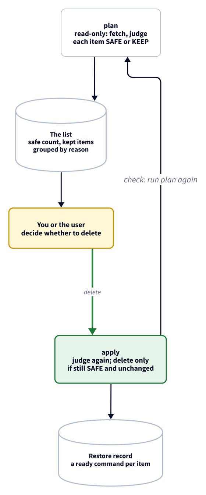
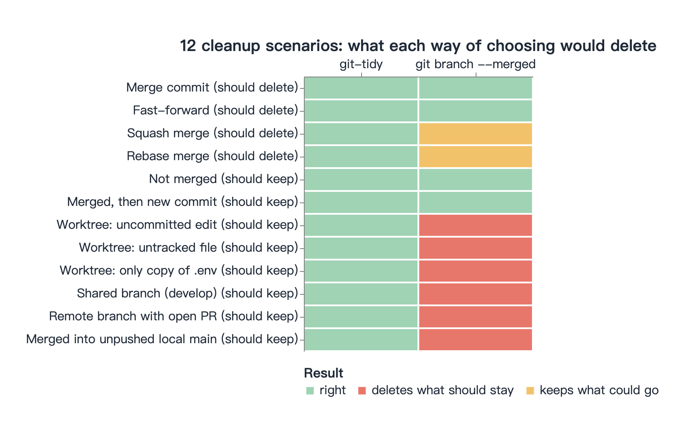

# git-tidy

[中文](README.zh.md)

Cleans up finished worktrees, local branches and remote branches, and deletes only what cannot lose work. It recognises a branch as merged even after a squash or rebase merge changed every commit id, and it re-checks each item right before deleting it.

## 1. When to use it

Use it when a repository has piled up worktrees and branches from finished work: "clean up merged branches", "too many worktrees", "tidy the remote branches". It is for a whole cleanup, not for deleting one named branch.

It is a command you run, not a skill: no agent starts it on its own. Run `git tidy plan` and `git tidy apply` yourself, or type `/git-tidy` in Claude Code to have the agent run it, help decide about worktrees kept only because of ignored files, and write a summary.

It suits repositories where coding agents open a worktree per task. Those pile up fast, often hold files git ignores (tool state, a `.env`), and are often merged by squash, which the usual `git branch --merged` does not see.

## 2. How it works



`plan` is read-only. It fetches, then judges every worktree and branch SAFE or KEEP and writes the reason. It prints the counts and the kept items grouped by reason. `apply` fetches and judges again, and deletes an item only if it is still SAFE and still points at the same commit. Every deletion goes into a restore record with a ready command to bring it back.

An item is SAFE only when its code is already in trunk (`origin/HEAD`, not your local main) and deleting it loses nothing:

| Check | Kept when |
|:---|:---|
| Code in trunk | Any change is missing from trunk. Four tests, cheapest first: ancestor of trunk; merging changes nothing; every commit has an equivalent patch (rebase merge); the whole branch as one patch has an equivalent commit (squash merge) |
| Worktree contents | Uncommitted changes, untracked files, or ignored files that are not regenerable caches |
| In use | A process has its current directory inside, or git activity in the last 12 hours, or the worktree is locked |
| Shared branches | main, master, develop, the release family and similar names are never deleted |
| Remote branches | An open pull request (or PR state cannot be read), or the latest commit is not yours |

Ignored files that matter, such as a `.env`, can be registered to be copied out before deletion (`git config --add git-tidy.salvage '.env'`). Ignored files that can go are registered as disposable.

## 3. Evidence

Twelve scenarios, each built in a throwaway repository whose right answer is known from how it was built. The same scenarios were given to git-tidy and to the selection step of the usual cleanup, `git branch --merged` (and `git branch -r --merged` for remote branches) excluding main and master.



| | Deletes what should stay | Keeps what could go |
|:---|:---:|:---:|
| git-tidy | 0 of 8 | 0 of 4 |
| `git branch --merged` | 6 of 8 | 2 of 4 |

The usual way misses squash and rebase merges, and would pick a shared `develop`, a branch with an open pull request, a branch merged only into an unpushed local main, and the worktrees of merged branches regardless of what is in them.

Result file: [`evals/git-tidy/results/2026-11-23-scenarios.json`](../../evals/git-tidy/results/2026-11-23-scenarios.json). To run it again: `python3 evals/git-tidy/run_scenarios.py`.

## 4. Limits

- The scenarios were written by the author, one per known risk. They show the rules work as designed; they do not measure how often each case happens in real repositories.
- The comparison is about choosing what to delete. Of the six items the usual way picks wrongly, git's own `git worktree remove` would still refuse two without `--force` (the uncommitted edit and the untracked file). It would not refuse the worktree whose only copy of `.env` is ignored: that file would be deleted silently.
- The scenarios switch off the 12-hour activity rule, since every repository in them was just created.
- Detecting "a process uses this worktree" needs `lsof` or `/proc`. When neither works, every worktree is kept.
- `/git-tidy` is a script plus instructions for the agent. With it, deletion still depends on the agent following the steps: it applies unless you asked only to list.

## 5. Requirements and install

Python 3.9 or newer and git 2.38 or newer (for `git merge-tree --write-tree`). `gh` is optional; without it, remote branches are kept because pull request state is unknown.

Install from the [repository root](../../README.md#install): `./install.sh git-tidy` links the program into `~/.local/bin`, and git runs it as `git tidy`. Without an agent:

```bash
git tidy plan --repo <repo>     # read-only: the list and the reasons
git tidy apply --repo <repo>    # delete what is still SAFE, write a restore record
```

Without installing it, run `python3 tools/git-tidy/scripts/git_tidy.py` in its place.

Tests: `python3 -m unittest discover -s tools/git-tidy/tests`.
